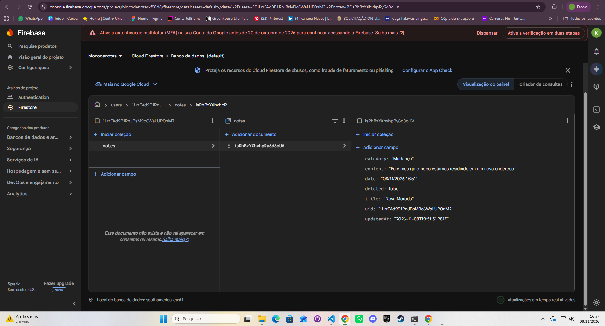
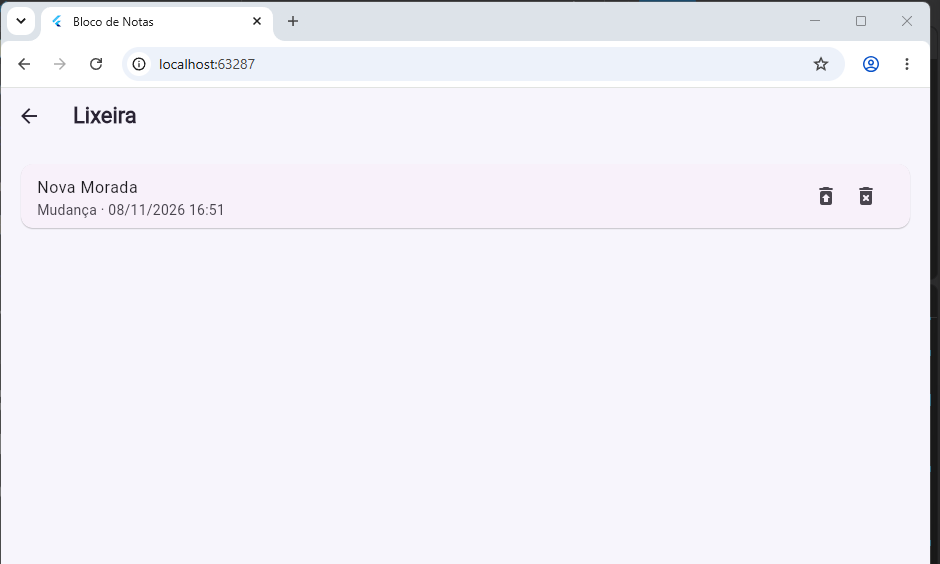

# Bloco de Notas (Flutter + SQLite + Firebase)

Aplicativo de notas com login, armazenamento local em SQLite e sincronização com o Cloud Firestore. Os dados de cada usuário ficam isolados por regras de segurança.

## Funcionalidades

- Cadastro, login e logout (Firebase Authentication, e-mail e senha).
- Criar, consultar, editar e excluir notas, no SQLite e no Firestore.
- Cada nota é associada ao usuário autenticado (campo `uid`).
- Categorias: Geral, Estudos, Trabalho, Pessoal e categorias criadas pelo usuário.
- Pesquisa por título ou conteúdo, combinável com o filtro por categoria.
- **Funcionalidade adicional: lixeira com recuperação.** A exclusão envia a nota para a lixeira. Dela é possível recuperar ou excluir definitivamente (apaga também no Firestore).
- Recuperação das notas da nuvem ao entrar novamente ou em outra instalação.
- Tratamento de erros de conexão e de permissão, com mensagens ao usuário.

## Tecnologias

Flutter e Dart, `sqflite` (e `sqflite_common_ffi_web` para rodar no navegador), `firebase_core`, `firebase_auth`, `cloud_firestore`.

## Como executar

Requisitos: Flutter com Dart 3.12 ou superior, Node.js e uma conta Google.

```bash
git clone https://github.com/karianeneves/bloco_de_nota_turma_B.git
cd bloco_de_nota_turma_B
git checkout melhorias-bloco-notas
flutter pub get
```

Configure o Firebase (próxima seção) e rode:

```bash
flutter run -d chrome
```

O projeto foi testado no Chrome (web).

## Configuração do Firebase

O arquivo `lib/firebase_options.dart` não é versionado, pois contém a configuração do projeto. O arquivo `lib/firebase_options.example.dart` mostra o formato esperado.

1. No Firebase Console, crie um projeto.
2. Ative **Authentication > E-mail/senha**.
3. Crie o **Firestore Database** (modo de produção).
4. Na aba Regras do Firestore, publique o conteúdo do arquivo `firestore.rules` deste repositório.
5. Gere o arquivo de configuração:

```bash
npm install -g firebase-tools
firebase login
dart pub global activate flutterfire_cli
dart pub global run flutterfire_cli:flutterfire configure --project=SEU_PROJECT_ID --platforms=web --yes
```

## Arquitetura e organização

```
lib/
  main.dart                      inicialização (Firebase e SQLite para web)
  firebase_options.dart          gerado localmente, fora do Git
  models/note.dart               modelo Note
  database/database_helper.dart  acesso ao SQLite
  services/auth_service.dart     autenticação
  services/sync_service.dart     comunicação com o Firestore e sincronização
  screens/                       login, cadastro, lista de notas, formulário, lixeira
  widgets/note_card.dart         card de nota
firestore.rules                  regras de segurança
docs/                            capturas de tela
```

### Padrões adotados

- **Singleton:** `DatabaseHelper.instance` e `SyncService.instance` garantem uma única conexão com o banco e um único ponto de acesso ao Firestore.
- **Camada de serviços:** `AuthService` e `SyncService` concentram a lógica de autenticação e de nuvem; as telas apenas chamam esses métodos.
- **Modelo com conversores:** `Note` possui `toMap`/`fromMap` (SQLite) e `toFirestore`/`fromFirestore` (nuvem), mantendo a conversão em um só lugar.

## Armazenamento local e integração com o Firebase

O SQLite é a fonte principal (local-first). A tabela `notes` guarda `sync_id`, `uid`, `title`, `content`, `category`, `date`, `updated_at`, `deleted` (lixeira) e `synced` (se já foi enviada). Na nuvem, cada nota fica em `users/{uid}/notes/{sync_id}`. O `sync_id` é o mesmo nos dois armazenamentos, o que permite relacionar os registros.

## Estratégia de sincronização e tratamento de erros

1. **Salvar, editar, mover para a lixeira ou recuperar:** grava primeiro no SQLite (`synced = 0`) e depois tenta enviar ao Firestore. Se o envio funcionar, marca `synced = 1`.
2. **Sem conexão ou falha:** a nota continua salva no aparelho, marcada como pendente, e o app avisa o usuário.
3. **Sincronização completa** (ao abrir a tela de notas e pelo botão de sincronizar): envia as pendentes e baixa as notas da nuvem. Em caso de conflito, vale a versão com `updated_at` mais recente.
4. **Exclusão definitiva:** apaga primeiro no Firestore. Se falhar, a nota permanece na lixeira.
5. As operações com a nuvem têm limite de 8 segundos. Erros de permissão (`permission-denied`) e de conexão geram mensagens específicas.

Limitações: a sincronização acontece ao abrir o app, ao salvar e pelo botão de sincronizar, sem atualização em tempo real. A exclusão definitiva exige conexão.

## Autenticação e segurança

- O acesso às notas exige usuário autenticado, e as consultas locais filtram por `uid`.
- As regras do Firestore (`firestore.rules`) permitem leitura e escrita apenas ao dono do caminho `users/{uid}/notes`, impedindo que um usuário veja ou altere as notas de outro.
- Nenhuma chave ou credencial é versionada: `firebase_options.dart` está no `.gitignore`.

## Capturas de tela

### Nota gravada no Firestore



### Lixeira do aplicativo

