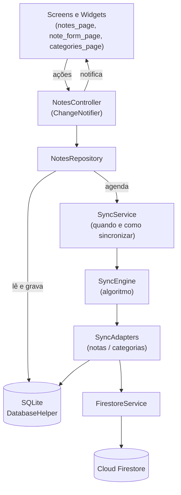
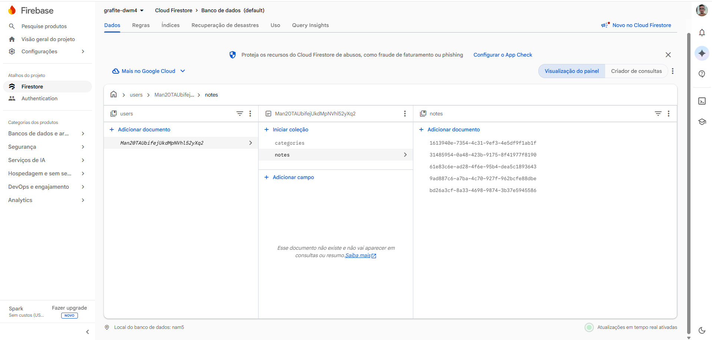
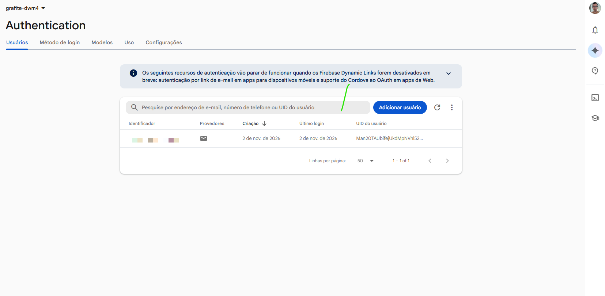
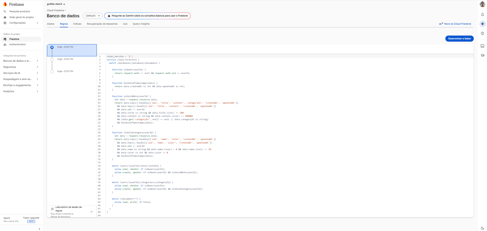
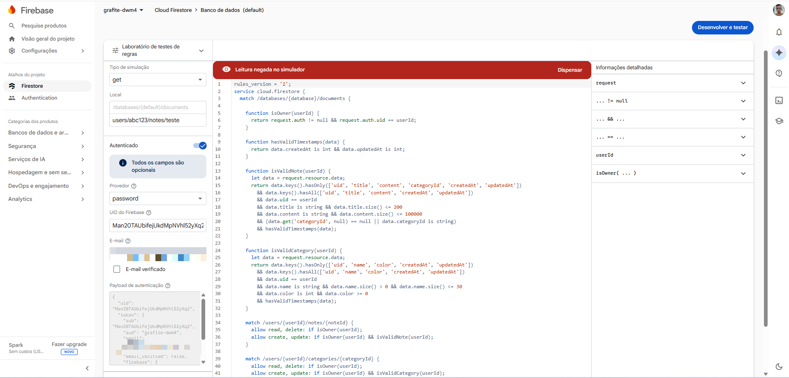

# Grafite — bloco de notas

**Grafite** é a evolução do Bloco de Notas da disciplina: um app Flutter de anotações com cara de caderno, que funciona sem internet e mantém as notas de cada usuário sincronizadas com o **Cloud Firestore**.

O objetivo é permitir que o usuário escreva a qualquer momento, inclusive offline, e encontre as mesmas notas ao entrar novamente ou em outra instalação, sem que outra pessoa consiga ver ou alterar o que é dele.

---

## Sumário

1. [Funcionalidades](#funcionalidades)
2. [Identidade visual](#identidade-visual)
3. [Tecnologias e dependências](#tecnologias-e-dependências)
4. [Como executar](#como-executar)
5. [Configurar o Firebase](#configurar-o-firebase)
6. [Arquitetura e organização dos arquivos](#arquitetura-e-organização-dos-arquivos)
7. [Padrões de projeto](#padrões-de-projeto)
8. [Armazenamento local (SQLite)](#armazenamento-local-sqlite)
9. [Integração com o Firebase](#integração-com-o-firebase)
10. [Estratégia de sincronização e tratamento de erros](#estratégia-de-sincronização-e-tratamento-de-erros)
11. [Autenticação e segurança dos dados](#autenticação-e-segurança-dos-dados)
12. [Testes](#testes)
13. [Capturas de tela](#capturas-de-tela)
14. [O que mudou em relação ao projeto base](#o-que-mudou-em-relação-ao-projeto-base)

---

## Funcionalidades

| Requisito | Como aparece no app |
|---|---|
| Cadastro, consulta, edição e exclusão de notas | Botão **Nova nota**, toque no cartão para editar, lixeira no cartão ou no editor. Toda operação grava no SQLite e é replicada no Firestore. |
| Notas associadas ao usuário | Cada nota guarda o `uid` do Firebase Auth e fica em `users/{uid}/notes` na nuvem. |
| Recuperar notas em outra instalação | Ao entrar, o app baixa as notas e categorias do usuário e grava no banco local. |
| Erros de conexão | Indicador de sincronização na barra superior (sincronizado / offline / erro / pendências) e mensagens claras. Nada é perdido sem internet. |
| Regras de segurança | [`firestore.rules`](firestore.rules): cada usuário só acessa `users/{seu uid}`, e os campos são validados. |
| Categorias | Estudos, Trabalho e Pessoal são criadas automaticamente. O usuário cria, renomeia, troca a cor e exclui categorias (menu **Categorias** ou o chip **+ Categoria**). |
| Associar categoria à nota | Seletor de categoria no topo do editor. |
| Pesquisa por título ou conteúdo | Campo de pesquisa na tela inicial. Ignora maiúsculas e acentos ("acao" encontra "Ação"), pode ser combinada com o filtro de categoria e destaca o trecho encontrado com marca-texto. |
| **Funcionalidade adicional: ordenação por data** | Botão de ordenação: por **última atualização** ou **data de criação**, das **mais recentes** ou **mais antigas** primeiro. A lista é agrupada em seções (Hoje, Ontem, Últimos 7 dias, Este mês, meses anteriores) e a escolha fica salva no aparelho. |

Também foram incluídos:

- Login automático: a sessão do Firebase Auth é mantida e o app abre direto nas notas.
- Salvamento ao voltar: sair do editor (seta ou gesto) salva a nota.
- Aviso ao sair da conta se ainda houver alterações não enviadas.
- Puxar a lista para baixo força uma sincronização.
- Tema claro e escuro, que seguem o sistema.

## Identidade visual

O app deixou de ser o "Bloco de Notas" genérico e virou o **Grafite**, inspirado em caderno de papel, lápis e marca-texto:

- **Paleta**: papel envelhecido (`#F3EEE4`), tinta de grafite (`#23211E`), marca-texto amarelo (`#F5D547`) e vermelho de borracha (`#D2553F`) para ações destrutivas. No tema escuro, o fundo vira grafite e o texto vira giz.
- **Tipografia**: *Fraunces* (serifada) nos títulos e no logotipo, *Inter* no texto e *Caveat* (manuscrita) em anotações de apoio, como os cabeçalhos das seções de data e os estados vazios.
- **Elementos**: cartões em forma de folha com margem vermelha de caderno, categorias como etiquetas de marca-texto, editor com pauta desenhada que rola junto com o texto e resultados de pesquisa grifados.

Todas as cores e fontes estão centralizadas em [`lib/theme/app_theme.dart`](lib/theme/app_theme.dart).

## Tecnologias e dependências

| Tecnologia | Uso |
|---|---|
| Flutter 3.47 / Dart 3.12 | Framework e linguagem |
| `firebase_core` | Inicialização do Firebase |
| `firebase_auth` | Login e cadastro com e-mail e senha |
| `cloud_firestore` | Armazenamento das notas na nuvem |
| `sqflite` + `path` | Banco local SQLite |
| `connectivity_plus` | Detecta perda e retorno da conexão para disparar a sincronização |
| `uuid` | Gera ids das notas no próprio aparelho, o que permite criar notas offline |
| `google_fonts` | Fontes Fraunces, Inter e Caveat |
| `flutter_test` | Testes de unidade |

As versões exatas estão em [`pubspec.yaml`](pubspec.yaml) e [`pubspec.lock`](pubspec.lock).

## Como executar

Pré-requisitos: Flutter SDK instalado (`flutter doctor` sem erros), um emulador Android ou aparelho físico e uma conta Google para o Firebase.

```bash
git clone <url-do-seu-fork>
cd Grafite
flutter pub get
```

Configure o Firebase (próxima seção). Isso gera os arquivos `lib/firebase_options.dart` e `android/app/google-services.json`, que **não são versionados**. Depois:

```bash
flutter run
```

Para rodar os testes:

```bash
flutter test
```

> O `sqflite` funciona em Android, iOS e macOS. Web e Windows não são suportados pelo banco local.

## Configurar o Firebase

1. Acesse o [console do Firebase](https://console.firebase.google.com/) e crie um projeto.
2. Em **Authentication → Método de login**, ative **E-mail/senha**.
3. Em **Firestore Database**, crie o banco de dados (modo de produção, região de sua preferência).
4. Instale as ferramentas (uma vez por computador):
   ```bash
   npm install -g firebase-tools
   ```
   ```bash
   dart pub global activate flutterfire_cli
   ```
5. Na pasta do projeto, faça login e gere a configuração:
   ```bash
   firebase login
   ```
   ```bash
   flutterfire configure
   ```
   Escolha o projeto criado e as plataformas (pelo menos Android). O comando cria `lib/firebase_options.dart` e `android/app/google-services.json`.
6. Publique as regras de segurança. Pelo terminal:
   ```bash
   firebase deploy --only firestore:rules
   ```
   Ou copie o conteúdo de [`firestore.rules`](firestore.rules) em **Firestore → Regras** no console e clique em **Publicar**.

### Por que os arquivos de configuração não estão no repositório

`firebase_options.dart` e `google-services.json` identificam um projeto Firebase específico. Eles estão no `.gitignore` para que cada pessoa use o próprio projeto e para não publicar identificadores do ambiente. Esses arquivos não contêm senhas: quem protege os dados é a combinação de **Firebase Auth** com as **regras do Firestore**. Nenhuma chave de conta de serviço ou credencial administrativa é usada pelo app.

## Arquitetura e organização dos arquivos

O app segue uma arquitetura em camadas, **offline-first**: a interface só conversa com o banco local, e a nuvem é alcançada por um serviço de sincronização.



```
lib/
├── main.dart                     # Inicializa o Firebase, temas e AuthGate (login x notas)
├── theme/app_theme.dart          # Identidade visual: cores, fontes, temas claro e escuro
├── models/
│   ├── note.dart                 # Nota + conversões SQLite (toMap) e Firestore (toFirestore)
│   ├── category.dart             # Categoria (NoteCategory)
│   ├── note_sort.dart            # Critério de ordenação por data
│   └── sync_status.dart          # synced / pending_upsert / pending_delete
├── database/database_helper.dart # SQLite: tabelas, consultas, pesquisa, preferências
├── services/
│   ├── auth_service.dart         # Firebase Auth + mensagens de erro em português
│   ├── firestore_service.dart    # Leitura e escrita no Firestore, com timeout
│   ├── sync_engine.dart          # Algoritmo de sincronização (independente de SQLite/Firebase)
│   ├── sync_adapters.dart        # Liga o algoritmo ao SQLite e ao Firestore
│   └── sync_service.dart         # Quando sincronizar, conectividade, erros e estado
├── repositories/notes_repository.dart  # Ponto único de acesso aos dados para a interface
├── controllers/notes_controller.dart   # Estado da tela: lista, pesquisa, filtro, ordenação
├── screens/                      # login, cadastro, notas, editor, categorias
├── widgets/                      # cartão da nota, indicador de sync, diálogos, pauta, logotipo
└── utils/                        # normalização de texto e formatação de datas
test/
├── sync_engine_test.dart         # Cenários de sincronização com armazenamentos em memória
└── utils_test.dart               # Pesquisa, ordenação e agrupamento por data
firestore.rules                   # Regras de segurança do Firestore
```

## Padrões de projeto

| Padrão | Onde | Por quê |
|---|---|---|
| **Repository** | `NotesRepository` | A interface não sabe se os dados vêm do SQLite ou do Firestore. Toda escrita segue o mesmo caminho (grava localmente como pendente e agenda a sincronização), então a regra fica num lugar só. |
| **Singleton** | `DatabaseHelper.instance` | Uma única conexão com o arquivo SQLite durante toda a execução, evitando abrir o banco várias vezes. |
| **Adapter** | `SyncAdapter`, `NoteSyncAdapter`, `CategorySyncAdapter` | O algoritmo de sincronização trabalha com uma interface genérica. Os adaptadores traduzem essa interface para os métodos do SQLite e do Firestore. Assim notas e categorias usam o mesmo algoritmo, e o algoritmo é testado com armazenamentos falsos. |
| **Observer** | `NotesController` (`ChangeNotifier`) com `ListenableBuilder`; `SyncService.state` (`ValueNotifier`) com `ValueListenableBuilder`; stream do `connectivity_plus` e `authStateChanges` | A tela reage a mudanças (nova nota, dados vindos da nuvem, mudança de conexão, login/logout) sem precisar consultar nada manualmente. |
| **Data Mapper** | `toMap`/`fromMap` e `toFirestore`/`fromFirestore` nos modelos | O mesmo objeto é salvo em dois formatos diferentes. O estado de sincronização existe só no SQLite e nunca vai para a nuvem. |
| **Outbox / Offline-first** | coluna `sync_status` | Alterações ficam numa "caixa de saída" local até a nuvem confirmar. É isso que garante que nada se perde sem internet. |

Separação de responsabilidades: as **screens** só desenham e repassam ações; o **controller** guarda o estado da tela; o **repository** aplica as regras de escrita; o **SyncService** decide quando sincronizar e trata erros; o **SyncEngine** contém só o algoritmo.

## Armazenamento local (SQLite)

Arquivo `grafite.db`, criado por [`DatabaseHelper`](lib/database/database_helper.dart):

| Tabela | Colunas principais |
|---|---|
| `notes` | `id` (UUID), `uid`, `title`, `content`, `category_id`, `created_at`, `updated_at`, `search_text`, `sync_status` |
| `categories` | `id`, `uid`, `name`, `color`, `created_at`, `updated_at`, `sync_status` |
| `settings` | `key`, `value` (ordenação escolhida, controle das categorias padrão) |

- **Ids UUID** gerados no aparelho: a mesma nota tem o mesmo id no SQLite e no Firestore, e notas criadas offline em aparelhos diferentes nunca colidem.
- **Datas** em milissegundos (`INTEGER`), o que facilita comparar versões e ordenar. Há índices em `(uid, updated_at)` e `(uid, created_at)` para a ordenação por data.
- **Pesquisa**: ao salvar, a nota grava em `search_text` o título e o conteúdo em minúsculas e sem acentos. A busca normaliza o termo do mesmo jeito e faz `LIKE '%termo%'` (escapando `%` e `_`), combinável com o filtro de categoria e a ordenação. Como todas as notas do usuário são baixadas para o SQLite, a pesquisa funciona offline e cobre também as notas vindas de outra instalação.
- **Isolamento por usuário**: todas as consultas filtram por `uid`. Se outra pessoa entrar no mesmo aparelho, não vê as notas da anterior.
- **Exclusão** é lógica até a nuvem confirmar: a linha recebe `pending_delete`, some da interface e só é apagada de vez depois que o Firestore remove o documento.

## Integração com o Firebase

Estrutura no Firestore:

```
users/{uid}/notes/{noteId}
    uid, title, content, categoryId, createdAt, updatedAt
users/{uid}/categories/{categoryId}
    uid, name, color, createdAt, updatedAt
```

[`FirestoreService`](lib/services/firestore_service.dart) faz as operações:

- Leitura com `GetOptions(source: Source.server)`, para considerar apenas o que está de fato na nuvem.
- `set` (criar/atualizar) e `delete` usando o mesmo id do SQLite, o que torna as operações **idempotentes**: reenviar a mesma nota não duplica nada.
- **Timeout de 12 s** em todas as operações. Sem resposta, a operação é tratada como falha de conexão.
- Documentos malformados são ignorados (e registrados no log) em vez de interromper a sincronização.

O **cache offline do Firestore é desativado** (`persistenceEnabled: false` em `main.dart`). Quem guarda os dados no aparelho é o SQLite. Assim existe uma única cópia local, e uma falha de rede aparece como erro tratado em vez de ficar escondida na fila interna do Firestore.

## Estratégia de sincronização e tratamento de erros

### Quando sincroniza

- Ao abrir o app (ou entrar na conta).
- Depois de cada criação, edição ou exclusão, com espera de 0,8 s para agrupar alterações seguidas.
- Quando a conexão volta (`connectivity_plus`).
- Quando o usuário puxa a lista para baixo ou toca no indicador de sincronização.
- Antes de sair da conta.

Se uma sincronização for pedida enquanto outra está rodando, ela é enfileirada e executada logo depois. Nunca rodam duas ao mesmo tempo.

### Como sincroniza

O algoritmo está em [`SyncEngine`](lib/services/sync_engine.dart) e roda primeiro para as categorias e depois para as notas:

1. **Baixa** todos os documentos do usuário no Firestore.
2. Para cada documento remoto:
   - não existe localmente → é inserido no SQLite (recuperação em nova instalação);
   - existe localmente sem pendências → a versão da nuvem substitui a local;
   - existe com alteração pendente → **vence o `updatedAt` mais recente** (*last-write-wins*).
3. Para cada registro local:
   - `synced` e ausente na nuvem → foi excluído em outro aparelho, então é removido daqui;
   - `pending_upsert` → é enviado ao Firestore e marcado como `synced`;
   - `pending_delete` → é apagado no Firestore e depois no SQLite.

Proteções contra condições de corrida:

- Uma versão vinda da nuvem nunca sobrescreve uma alteração local **mais nova** feita enquanto a sincronização rodava.
- Um registro só é marcado como `synced` se o `updatedAt` não mudou desde o envio.

### Tratamento de erros

| Situação | O que o app faz |
|---|---|
| Aparelho sem rede | Nem tenta acessar o Firebase. Mostra "offline" e o número de alterações pendentes. |
| Rede presente, mas o Firebase não responde (timeout, `unavailable`) | Estado offline e nova tentativa automática no próximo gatilho. |
| `permission-denied` | Mensagem indicando problema nas regras de segurança. |
| `unauthenticated`, `resource-exhausted` e outros | Mensagem específica, e os dados continuam pendentes. |
| Documento inválido na nuvem | É ignorado, e o restante sincroniza normalmente. |
| Erros de login e cadastro | Códigos do Firebase Auth traduzidos (senha fraca, e-mail em uso, sem conexão...). |

Em qualquer falha, nada é descartado: o que não foi confirmado continua pendente no SQLite e é reenviado depois.

**Limitações conhecidas**: o conflito é resolvido por registro inteiro (a versão mais recente vence, sem mesclar textos) e depende do relógio dos aparelhos. Uma nota editada offline num aparelho e excluída em outro volta a existir na próxima sincronização, o que é preferível a perder a edição.

## Autenticação e segurança dos dados

- **Firebase Authentication** com e-mail e senha. O `AuthGate` (`main.dart`) observa `authStateChanges()`: sem usuário mostra o login, com usuário mostra as notas daquele `uid`.
- Cada nota e categoria guarda o `uid` do dono, tanto no SQLite quanto no Firestore.
- **Regras do Firestore** ([`firestore.rules`](firestore.rules)):
  - leitura e escrita só em `users/{userId}/...` quando `request.auth.uid == userId`;
  - na criação e na atualização, o campo `uid` precisa ser igual ao do usuário autenticado (ninguém grava em nome de outro);
  - validação de tipos e tamanhos (título ≤ 200, conteúdo ≤ 100.000 caracteres, nome de categoria ≤ 30) e de campos permitidos;
  - qualquer outro caminho do banco é negado.
- Nenhuma senha, chave privada ou arquivo de credencial está no repositório. Os arquivos gerados pelo `flutterfire configure` estão no `.gitignore`.

Para verificar as regras, use o **Simulador de regras** do console (Firestore → Regras): uma leitura em `users/OUTRO_UID/notes/x` autenticada como outro usuário deve ser **negada**.

## Testes

```bash
flutter test
```

- `test/sync_engine_test.dart`: envio de nota criada offline; recuperação em instalação nova; exclusão propagada nos dois sentidos; conflitos (local mais novo e remoto mais novo); falha de conexão sem perda de dados.
- `test/utils_test.dart`: pesquisa sem acentos e maiúsculas, trecho exibido no cartão, `ORDER BY` da ordenação, persistência da preferência e agrupamento por data.

## Capturas de tela

As imagens ficam em `docs/screenshots/`.

### Aplicativo

| Login | Lista agrupada por data | Pesquisa com destaque |
|---|---|---|
|  |  |  |

| Editor com categoria | Ordenação por data | Categorias |
|---|---|---|
|  |  |  |

| Offline com pendências | Tema escuro |
|---|---|
|  |  |

### Evidências no Firebase

| Notas no Firestore | Categorias no Firestore |
|---|---|
|  |  |

| Usuários no Authentication | Regras publicadas | Simulador negando acesso de outro usuário |
|---|---|---|
|  |  |  |

## O que mudou em relação ao projeto base

| Arquivo / componente | Alteração |
|---|---|
| `lib/main.dart` | Tema Grafite (claro/escuro), cache do Firestore desativado, `AuthGate` com login automático. |
| `lib/models/note.dart` | Id UUID, `categoryId`, `createdAt`/`updatedAt` em milissegundos, `syncStatus` e conversões para o Firestore. |
| `lib/database/database_helper.dart` | Novo esquema (`notes`, `categories`, `settings`), pesquisa normalizada, ordenação, exclusão lógica e operações de sincronização. |
| `lib/services/auth_service.dart` | Mensagens de erro em português. |
| `lib/screens/*` | Telas redesenhadas, pesquisa, filtros por categoria, ordenação, gestão de categorias e editor com salvamento ao voltar. |
| `lib/widgets/note_card.dart` | Cartão em forma de folha com categoria, destaque da pesquisa e indicador de pendência. |
| Novos | `controllers/`, `repositories/`, `services/firestore_service.dart`, `services/sync_*.dart`, `theme/`, `utils/`, demais widgets, `firestore.rules` e a pasta `test/`. |
| Configuração | App renomeado para **Grafite** (Android, iOS e web), `firebase.json` aponta para as regras, e os arquivos de configuração do Firebase saíram do versionamento. |
