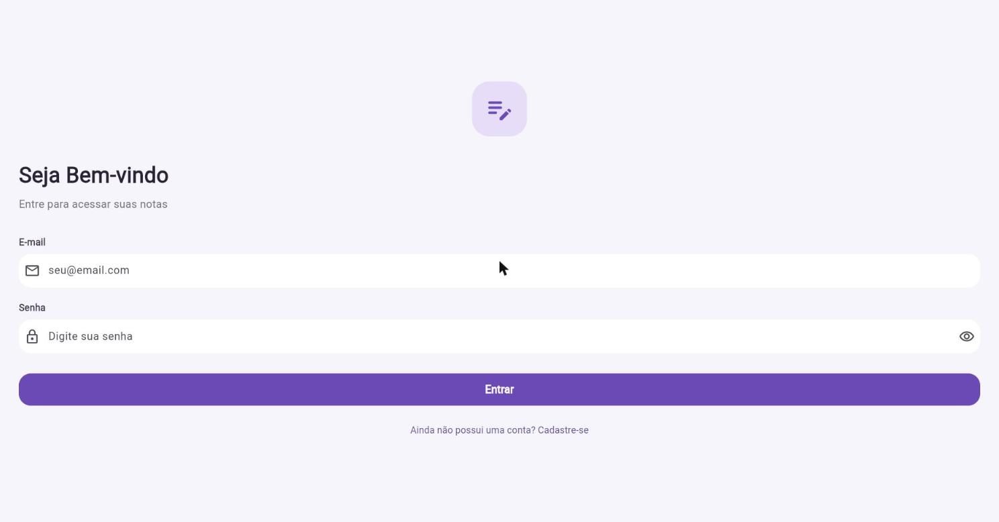
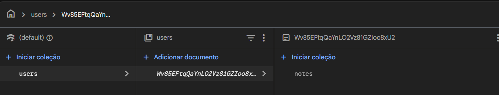
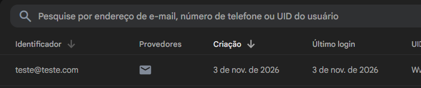
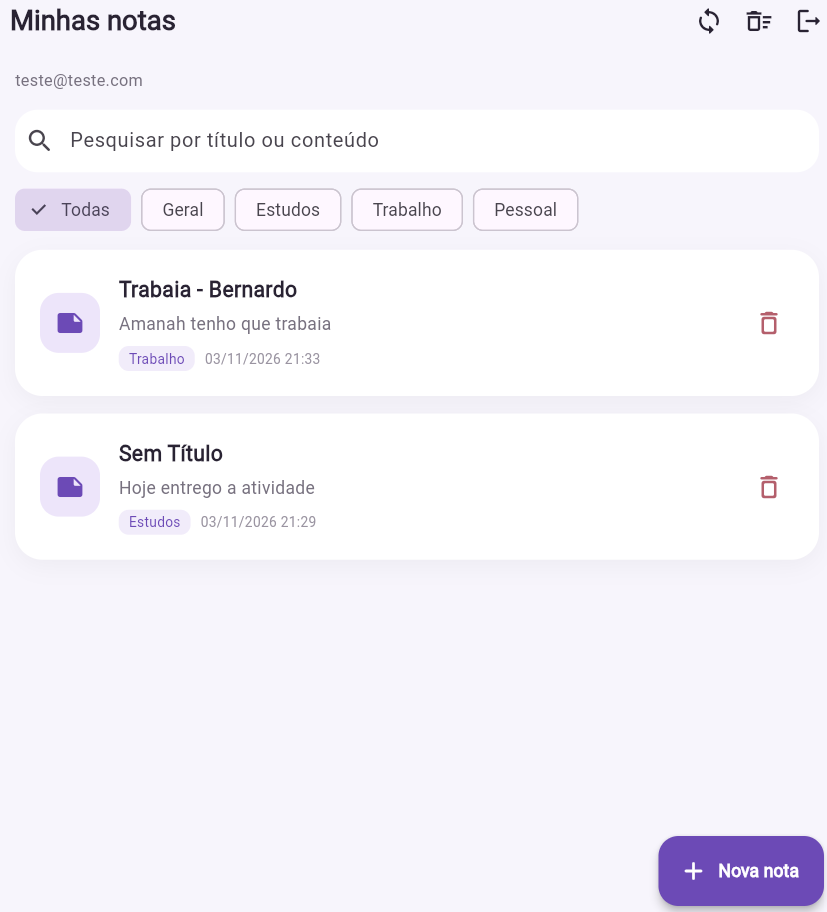

# Bloco de Notas: Flutter, SQLite e Firebase

Aplicativo de bloco de notas que guarda as notas **no aparelho (SQLite)** e **na nuvem (Cloud Firestore)**. Cada nota pertence ao usuário autenticado pelo **Firebase Authentication**. O app funciona sem internet e sincroniza as notas quando a conexão volta.

Projeto evoluído a partir do repositório da professora (`LopesBrendinha/bloco_de_nota_turma_B`), desenvolvido na branch `desenvolvimento`.

---

## Funcionalidades

| Funcionalidade | Como funciona |
|---|---|
| Cadastro e login | E-mail e senha pelo Firebase Auth. A sessão fica salva, então quem já entrou vai direto para as notas. |
| CRUD de notas | Criar, consultar, editar e excluir notas. Toda operação grava no SQLite e no Firestore. |
| Funciona offline | Sem conexão, a nota é salva só no aparelho, aparece com o ícone ☁️ riscado e sobe para a nuvem na próxima sincronização. |
| Sincronização | Acontece ao abrir o app, ao puxar a lista para baixo e no botão 🔄. As notas são recuperadas ao entrar de novo ou em outra instalação. |
| Categorias | Padrões: Geral, Estudos, Trabalho e Pessoal. O usuário também cria as suas pelo chip **+ Nova** no formulário. |
| Pesquisa | Busca pelo título **ou** pelo conteúdo enquanto se digita. Pode ser combinada com o filtro de categoria. |
| Ordenação | As notas aparecem da última atualizada para a mais antiga. |
| **Lixeira com recuperação** (funcionalidade adicional) | Excluir manda a nota para a lixeira (com **Desfazer**). Na lixeira dá para **restaurar**, **excluir definitivamente** ou **esvaziar** tudo. O estado da lixeira também é sincronizado com a nuvem. |
| Segurança | Regras do Firestore: cada usuário só lê e grava as próprias notas. |

---

## Tecnologias e dependências

| Pacote | Uso |
|---|---|
| Flutter 3.47 / Dart 3.13 | Framework e linguagem |
| `firebase_core` | Inicialização do Firebase |
| `firebase_auth` | Autenticação por e-mail e senha |
| `cloud_firestore` | Banco de dados na nuvem |
| `sqflite` + `path` | Banco de dados local (SQLite) |
| `uuid` | Gera o ID global de cada nota (`remoteId`) |
| `sqflite_common_ffi` (dev) | SQLite em memória nos testes |
| `fake_cloud_firestore` (dev) | Firestore falso nos testes |
| `@firebase/rules-unit-testing` + `firebase-tools` (dev, Node) | Testa as regras de segurança no emulador |

---

## Como executar

### Pré-requisitos
- Flutter SDK 3.47 ou mais recente (`flutter --version`)
- Android Studio com um emulador, ou um celular com depuração USB
- Node.js 18 ou mais recente, só para o Firebase CLI e os testes de regras

### Passos
```bash
git clone https://github.com/<seu-usuario>/bloco_de_nota_turma_B.git
cd bloco_de_nota_turma_B
git checkout desenvolvimento
flutter pub get
flutter run
```

### Testes
```bash
flutter test                                  # 25 testes: modelo, SQLite, sincronização e widget
cd firestore_rules_test && npm install && npm test   # 7 testes das regras (precisa de Java 11+)
```

---

## Configuração do Firebase

O repositório já traz `lib/firebase_options.dart` e `android/app/google-services.json` do projeto original. Para usar o **seu** projeto:

1. Crie um projeto em <https://console.firebase.google.com>.
2. **Authentication** → *Começar* → ative **E-mail/senha**.
3. **Firestore Database** → *Criar banco de dados* → modo de produção.
4. Instale as ferramentas (no CMD ou PowerShell):
   ```bash
   npm install -g firebase-tools
   firebase login
   dart pub global activate flutterfire_cli
   ```
5. Na raiz do projeto, gere a configuração do app:
   ```bash
   flutterfire configure --project=<id-do-seu-projeto>
   ```
   Esse comando recria `lib/firebase_options.dart` e `android/app/google-services.json`.
6. Publique as regras de segurança:
   ```bash
   firebase deploy --only firestore:rules --project <id-do-seu-projeto>
   ```

> **Sobre chaves:** os valores em `firebase_options.dart` e `google-services.json` (apiKey, appId, projectId) **identificam** o projeto, mas não são senhas. O Firebase foi feito para que eles fiquem no app. O que protege os dados é o login (Auth) junto com as **regras do Firestore**. Nenhuma senha, chave de conta de serviço (`serviceAccount*.json`) ou token fica no repositório. Se quiser mais proteção, restrinja a API key ao pacote Android no Google Cloud Console.

---

## Arquitetura e organização

```
lib/
├── main.dart                        # Inicializa o Firebase e escolhe a tela inicial (login ou notas)
├── firebase_options.dart            # Gerado pelo FlutterFire CLI
├── models/
│   └── note.dart                    # Entidade Note + conversões SQLite (toMap) e Firestore (toFirestore)
├── database/
│   └── database_helper.dart         # SQLite: tabela, migração v1→v2, consultas com pesquisa e filtro
├── services/
│   ├── auth_service.dart            # Login, cadastro e logout (Firebase Auth)
│   └── note_remote_service.dart     # Interface NoteRemoteDataSource + implementação com Firestore
├── repositories/
│   └── note_repository.dart         # Regras de negócio: salvar local e na nuvem, lixeira, sincronização
├── screens/
│   ├── login_page.dart / register_page.dart
│   ├── notes_page.dart              # Lista, pesquisa, filtro por categoria, sincronizar
│   ├── note_form_page.dart          # Criar ou editar nota e escolher ou criar categoria
│   └── trash_page.dart              # Lixeira: restaurar, excluir de vez, esvaziar
└── widgets/
    └── note_card.dart               # Card da nota (categoria, data, ícone de pendência)
test/                                # Testes Flutter
firestore.rules                      # Regras de segurança do Firestore
firestore_rules_test/                # Testes das regras no emulador
```

Fluxo das camadas: **Tela → NoteRepository → (DatabaseHelper | NoteRemoteDataSource)**. As telas não acessam o SQLite nem o Firestore diretamente.

### Padrões de projeto adotados

| Padrão | Onde | Por quê |
|---|---|---|
| **Repository** | `NoteRepository` | Junta as duas fontes de dados num lugar só. As telas chamam `save`, `moveToTrash` e `sync` sem saber que existem SQLite e Firestore por trás. |
| **Abstração e injeção de dependência** | `NoteRemoteDataSource` (interface) e os construtores de `NoteRepository` e `DatabaseHelper` | O repositório depende da interface, não do Firestore. Nos testes entram um Firestore falso e um remoto que simula estar offline, e o SQLite roda em memória. |
| **Singleton** | `DatabaseHelper.instance` | Uma única conexão com o arquivo `notes.db` em todo o app. |
| **Offline-first** | `NoteRepository.save` / `sync` | O SQLite é a fonte da interface, então o app responde na hora e funciona sem internet. A nuvem é atualizada em seguida. |
| **Soft delete** | Campos `trashed` e `purged` | A lixeira só marca a nota. `purged` guarda uma exclusão definitiva feita offline até ela ser confirmada na nuvem. |

---

## Armazenamento local e integração com o Firebase

### SQLite (tabela `notes`, versão 2)

| Coluna | Descrição |
|---|---|
| `id` | Chave local (autoincremento) |
| `remote_id` | UUID da nota, que é o mesmo ID do documento no Firestore. É ele que liga as duas bases. |
| `uid` | Dono da nota (UID do Firebase Auth) |
| `title`, `content`, `category` | Dados da nota |
| `created_at`, `updated_at` | Datas em milissegundos |
| `trashed` | 1 = está na lixeira |
| `synced` | 0 = há alteração local ainda não enviada |
| `purged` | 1 = excluída definitivamente, aguardando a remoção na nuvem |

A **migração v1 → v2** (`DatabaseHelper._onUpgrade`) mantém as notas criadas na versão antiga do app. Elas ganham um `remote_id`, a categoria "Geral" e `synced = 0`, então sobem para a nuvem no primeiro sync.

### Firestore

Caminho: `users/{uid}/notes/{remoteId}`

```json
{ "uid": "...", "title": "...", "content": "...", "category": "Estudos",
  "createdAt": Timestamp, "updatedAt": Timestamp, "trashed": false }
```

As flags `synced` e `purged` existem só no aparelho. A persistência offline do próprio Firestore foi desligada (`main.dart`) para que o SQLite seja o único cache local e as leituras da nuvem venham sempre do servidor.

---

## Estratégia de sincronização e tratamento de erros

**Ao salvar, editar ou mover para a lixeira** (`NoteRepository.save`):
1. Grava no SQLite com `synced = 0`.
2. Tenta enviar ao Firestore (`set` com timeout de 8 s).
3. Se der certo, marca `synced = 1`. Se falhar (sem internet, timeout, permissão), a nota continua salva no aparelho, o card mostra ☁️ riscado e aparece o aviso *"Salva no aparelho. Será enviada à nuvem quando houver conexão."*

**Exclusão definitiva** (`deleteForever`): marca `purged = 1` (a nota some da tela) e tenta apagar na nuvem. Só remove a linha local depois que a nuvem confirma. Sem conexão, a exclusão é concluída no próximo sync.

**Sincronização completa** (`NoteRepository.sync`), executada ao abrir o app, ao puxar para atualizar e no botão 🔄:
1. **Baixa** todas as notas do usuário (`Source.server`).
2. **Mescla** pelo `remoteId`:
   - existe só na nuvem → é inserida localmente (por exemplo, numa nova instalação);
   - existe nos dois → **vence o `updatedAt` mais recente** (*last-write-wins*);
   - existia localmente já sincronizada, mas sumiu da nuvem → foi excluída em outro aparelho, então é apagada aqui.
3. **Envia** as pendências locais (`synced = 0`): faz upsert das notas e delete das `purged`.

Se qualquer etapa falhar, `sync` retorna `false`, os dados locais ficam intactos e a tela mostra *"Sem conexão com a nuvem. Exibindo as notas salvas no aparelho."* Como as operações são idempotentes (`set` e `delete` por ID), dá para repetir sem duplicar nada.

**Limitação conhecida:** se a mesma nota for editada em dois aparelhos ao mesmo tempo sem conexão, fica a versão com a data de alteração mais recente.

**Pesquisa:** é feita no SQLite (`LIKE` em título e conteúdo, com filtro opcional de categoria). Como o sync traz todas as notas da nuvem para o banco local, a pesquisa cobre tanto as notas criadas no aparelho quanto as recuperadas da nuvem, e funciona offline.

---

## Autenticação e segurança

- **Firebase Auth (e-mail/senha):** o UID do usuário vai em toda nota e em toda consulta local (`WHERE uid = ?`). No mesmo aparelho, um usuário não vê as notas de outro.
- **Regras do Firestore** (`firestore.rules`):
  - leitura e exclusão só se `request.auth.uid == userId` do caminho;
  - criação e edição exigem dono, `uid` igual ao do caminho, tipos corretos, tamanho máximo dos campos e nenhum campo extra;
  - qualquer outro caminho é negado.
- As regras são testadas no emulador (`firestore_rules_test/rules.test.js`). Os testes confirmam que o dono consegue fazer o CRUD e que outro usuário ou um visitante sem login **não consegue** ler, listar, alterar ou excluir.

---

## Testes automatizados

| Arquivo | O que cobre |
|---|---|
| `test/note_model_test.dart` | Conversões SQLite e Firestore, formatação de data |
| `test/database_migration_test.dart` | Migração do banco v1 → v2 sem perder notas |
| `test/note_repository_test.dart` | CRUD nos dois armazenamentos, pesquisa, categorias, ordenação, lixeira, operação offline, reenvio de pendências, recuperação em outra instalação, conflito e isolamento entre usuários |
| `test/note_card_test.dart` | Card exibe a categoria e o indicador de pendência, e o botão excluir funciona |
| `firestore_rules_test/rules.test.js` | Regras de segurança do Firestore |

---

## Capturas de tela

### Aplicativo
**Tela de login**



### Evidências no Firebase
**Firestore:** notas gravadas em `users/{uid}/notes`, uma subcoleção por usuário



**Authentication:** conta criada pelo app (e-mail/senha)



---|---|
| Login |  |
| Lista com categorias e pesquisa |  |
| Formulário com categorias |  |
| Nota pendente (offline) |  |
| Lixeira |  |
| **Firebase:** Firestore com `users/{uid}/notes` |  |
| **Firebase:** usuários no Authentication |  |
| **Firebase:** regras publicadas |  |

---

## Alterações em relação ao projeto original

- **Correção:** `DatabaseHelper.instace` e `DatabaseHelper.ínstance` (com erro de digitação) impediam a compilação. Agora é `instance`.
- `models/note.dart`: novos campos (`remoteId`, `category`, datas, `trashed`, `synced`, `purged`) e conversão para o Firestore.
- `database/database_helper.dart`: schema v2 com migração, pesquisa, filtro, categorias e consultas para o sync.
- **Novos:** `services/note_remote_service.dart`, `repositories/note_repository.dart`, `screens/trash_page.dart`, `firestore.rules`, testes.
- `screens/notes_page.dart`: pesquisa, chips de categoria, sincronização, acesso à lixeira e "Desfazer".
- `screens/note_form_page.dart`: seleção e criação de categoria, salvamento pelo repositório e aviso de modo offline.
- `widgets/note_card.dart`: mostra a categoria e o indicador de pendência, e aceita outras ações (usado na lixeira).
- `main.dart`: login persistente e Firestore sem cache próprio.
