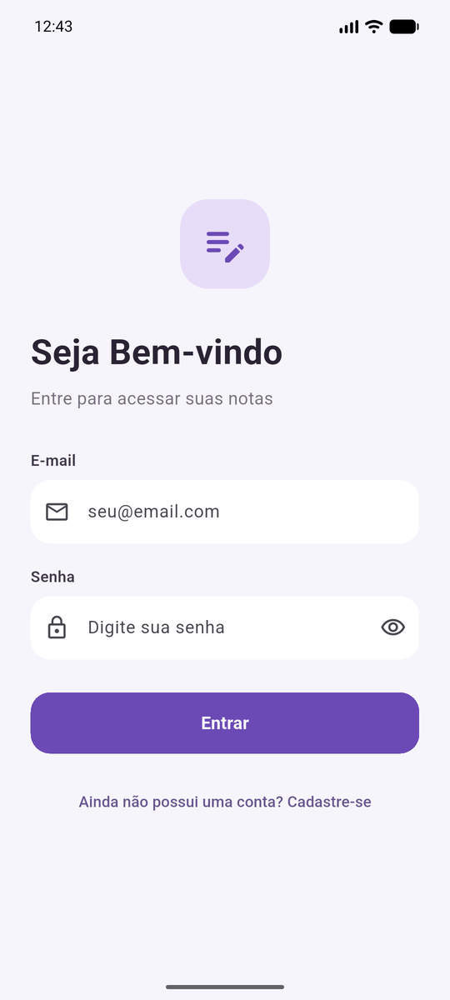
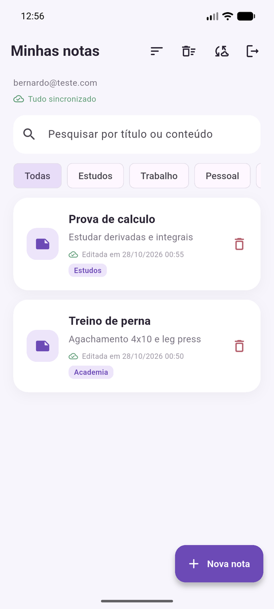
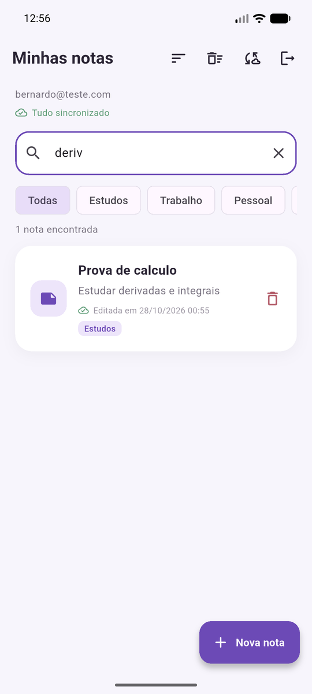
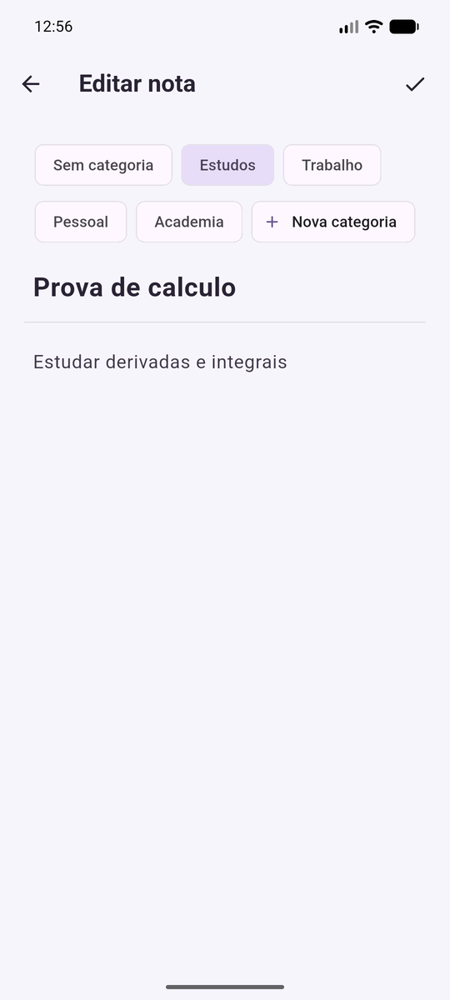
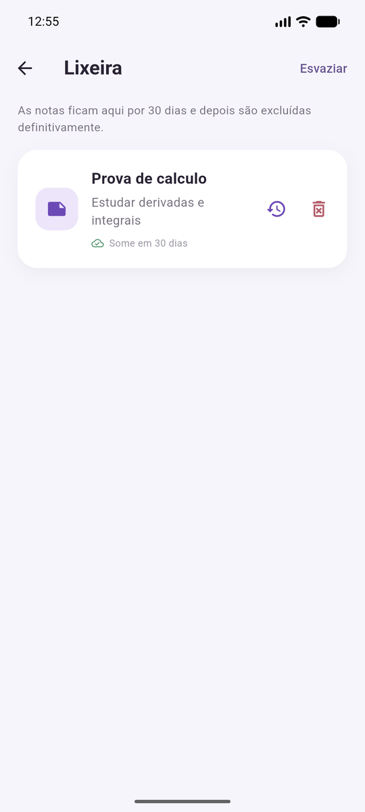
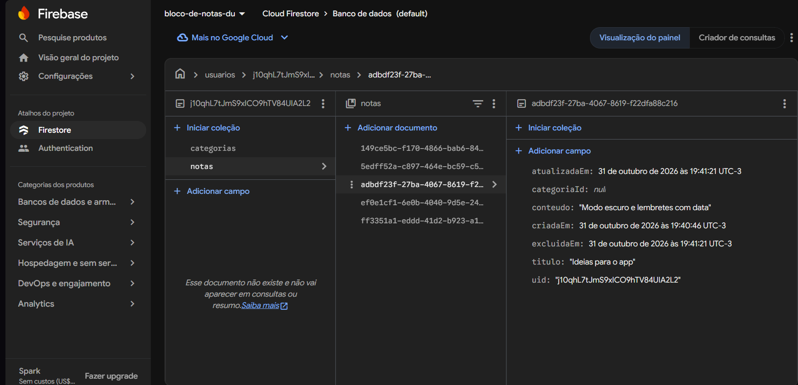
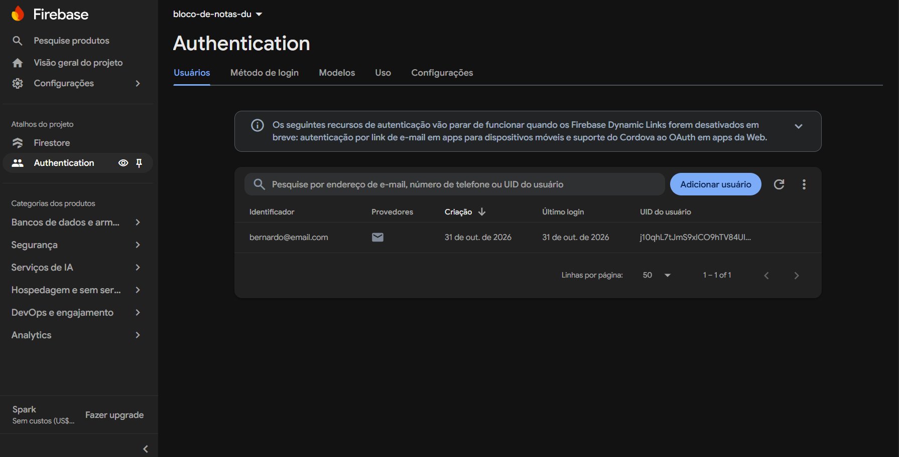
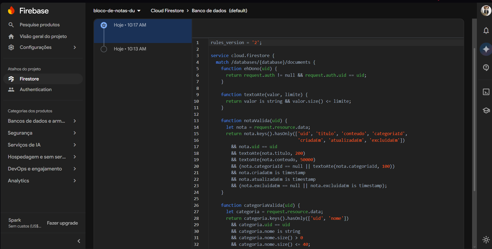

# Bloco de Notas

**Eduardo Sochodolak** — 6º Período

App de anotações em Flutter que guarda as notas no celular (SQLite) e sincroniza com o Cloud Firestore. Dá pra usar sem internet, e ao entrar com a mesma conta em outro aparelho as notas voltam da nuvem.

Parti do projeto da professora ([bloco_de_nota_turma_B](https://github.com/LopesBrendinha/bloco_de_nota_turma_B)) e desenvolvi tudo na branch `desenvolvimento`.

## Funcionalidades

- Cadastro e login com e-mail e senha (Firebase Authentication), com as mensagens de erro em português
- Criar, editar, listar e excluir notas, salvando no SQLite e no Firestore
- Sincronização ao abrir o app, ao puxar a lista pra baixo ou no botão de nuvem, com um indicador de quantas alterações faltam enviar
- Categorias: Estudos, Trabalho e Pessoal já vêm prontas e dá pra criar outras no formulário da nota
- Pesquisa por título ou conteúdo, que dá pra combinar com o filtro de categoria
- **Lixeira com recuperação** (funcionalidade adicional): a nota excluída vai pra lixeira, onde dá pra restaurar, apagar de vez ou esvaziar tudo. Depois de 30 dias ela some sozinha, do aparelho e da nuvem
- Ordenação pela data de criação ou pela última edição

## Tecnologias

Flutter 3.47 / Dart 3.13, `firebase_core`, `firebase_auth`, `cloud_firestore`, `sqflite`, `path` e `uuid`.
Nos testes usei `fake_cloud_firestore` (Firestore em memória) e `sqflite_common_ffi` (SQLite rodando no PC).

## Como rodar

Precisa do Flutter SDK e de um emulador ou celular Android (o `sqflite` não roda no navegador).

```bash
git clone https://github.com/<seu-usuario>/bloco_de_nota_turma_B.git
cd bloco_de_nota_turma_B
git checkout desenvolvimento
flutter pub get
flutter run
```

Testes: `flutter test` (12 testes cobrindo sincronização, pesquisa, categorias e lixeira).

## Configurando o Firebase

O repositório já vem apontando pro meu projeto Firebase, o `bloco-de-notas-du` (`lib/firebase_options.dart` e `android/app/google-services.json`). Esses arquivos só identificam o projeto e não dão acesso aos dados, porque quem protege as notas é o login junto com as regras do Firestore. Pra usar um projeto seu:

1. Crie o projeto no [console do Firebase](https://console.firebase.google.com)
2. Em **Authentication**, ative o login por **E-mail/senha**
3. Em **Firestore Database**, crie o banco no modo produção
4. Gere a configuração e publique as regras:

```bash
npm install -g firebase-tools
firebase login
dart pub global activate flutterfire_cli
flutterfire configure --project=<id-do-projeto>
firebase deploy --only firestore:rules --project <id-do-projeto>
```

Senhas, tokens e chaves de conta de serviço não vão pro repositório, e o app nem precisa deles.

Também dá pra testar com o Emulator Suite, sem projeto real: `firebase emulators:start --only auth,firestore --project bloco-de-notas-du` e depois `flutter run --dart-define=EMULADOR=true`.

## Organização do código

```
lib/
├── main.dart              inicia o Firebase e escolhe a tela inicial
├── modelos/               Nota, Categoria, Ordenacao, ResultadoSincronizacao
├── dados/
│   ├── banco_local.dart   SQLite
│   └── nuvem_notas.dart   Firestore
├── repositorios/
│   └── repositorio_notas.dart   junta o SQLite e o Firestore
├── servicos/              autenticação
├── telas/                 login, cadastro, notas, formulário e lixeira
├── componentes/           widgets reaproveitados (cartão, seletor de categorias, diálogos)
└── utilitarios/           formatação de data
test/                      testes do repositório
firestore.rules            regras de segurança
```

As telas não falam direto com o SQLite nem com o Firestore: tudo passa pelo `RepositorioNotas`.

## Padrões usados

- **Repository** (`RepositorioNotas`): a tela só pede "salvar", "listar" ou "sincronizar" e não sabe de onde vem o dado. Com isso a regra de sincronização fica num lugar só e dá pra testar sem interface.
- **Singleton** (`BancoLocal.instancia`): uma conexão só com o `notes.db` pro app inteiro.
- **Adapter** (`Nota.paraMapa`/`doMapa` e `NuvemNotas`): converte a nota pro formato de cada banco (milissegundos e 0/1 no SQLite, `Timestamp` no Firestore).
- **Injeção de dependência**: o repositório recebe o banco local e a nuvem pelo construtor. Nos testes passo um SQLite temporário e um Firestore falso, ou uma nuvem que sempre falha pra simular falta de internet.
- **Objeto imutável**: `editar`, `moverParaLixeira`, `restaurar` e `apagar` sempre devolvem uma nota nova, com a data atualizada e marcada como pendente, então nenhuma alteração fica sem ser enviada.

## Armazenamento e sincronização

No **SQLite** ficam as tabelas `notas` e `categorias`. Cada linha tem o `uid` do dono e uma coluna `sincronizada` (0 = falta enviar). O id da nota é um UUID, o mesmo do documento no Firestore. Quem tinha o banco antigo (tabela `notes`) tem as notas migradas automaticamente.

No **Firestore** cada usuário tem a própria pasta: `usuarios/{uid}/notas` e `usuarios/{uid}/categorias`.

A tela sempre lê do SQLite, por isso abre rápido e funciona offline. O fluxo é este:

1. **Salvar:** grava no SQLite com `sincronizada = 0` e tenta enviar na hora. Exclusão definitiva não apaga a linha logo: marca `apagada = 1` pra que a exclusão também chegue na nuvem.
2. **Enviar pendentes:** manda pro Firestore o que está com `sincronizada = 0` e só depois marca como enviado.
3. **Sincronizar:** baixa tudo do servidor e compara nota por nota:
   - existe só na nuvem: baixa (é o caso de outro aparelho ou de reinstalação)
   - existe só no aparelho e já tinha sido enviada: foi apagada em outro aparelho, então remove
   - existe nos dois: fica a versão com a edição mais recente

   Depois envia as pendentes.

Desliguei o cache offline do próprio Firestore (`persistenceEnabled: false`), senão ele fingia que salvou mesmo sem internet e o app não saberia o que ainda falta enviar.

### Tratamento de erros

- Toda chamada ao Firestore tem tempo limite de 10 segundos
- Sem internet, o app avisa que as notas continuam no aparelho e mostra quantas faltam enviar. Nada é apagado nem perdido, e o envio acontece na próxima tentativa
- `permission-denied` mostra que as regras recusaram, e qualquer outro erro pede pra tentar de novo
- As sincronizações rodam em fila, uma de cada vez, pra não atropelar uma à outra

## Autenticação e segurança

- Toda nota e categoria guarda o `uid` de quem criou, e as consultas no SQLite filtram por ele. Se duas contas usarem o mesmo celular, uma não vê as notas da outra
- As regras do Firestore ([firestore.rules](firestore.rules)) só deixam o próprio usuário ler e gravar em `usuarios/{uid}`. Elas também validam os campos: título até 200 caracteres, conteúdo até 50.000 e datas do tipo timestamp

## O que mudou em relação ao projeto base

- `models`, `database`, `services`, `screens` e `widgets` viraram `modelos`, `dados`, `servicos`, `telas` e `componentes`, com nomes em português
- Novos: `nuvem_notas.dart`, `repositorio_notas.dart`, tela de lixeira, componentes de categoria e de sincronização, `firestore.rules` e os testes
- Corrigi o nome do singleton do banco (`instace`), que impedia a compilação
- Adicionei a permissão de internet no `AndroidManifest.xml`

## Capturas de tela

| Login | Notas | Pesquisa | Formulário | Lixeira |
|---|---|---|---|---|
|  |  |  |  |  |

### Firebase

| Notas no Firestore | Usuários no Authentication | Regras publicadas |
|---|---|---|
|  |  |  |
