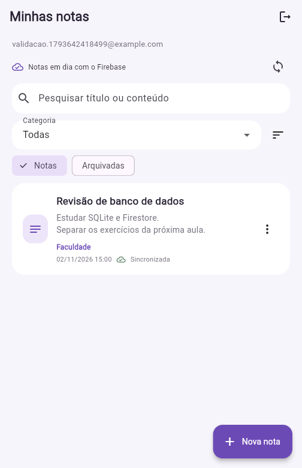
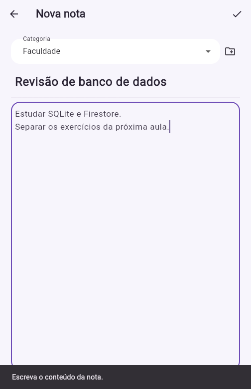
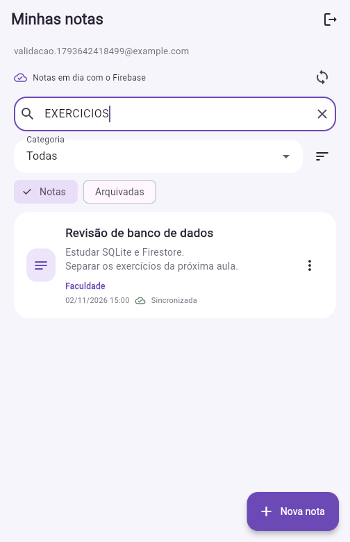
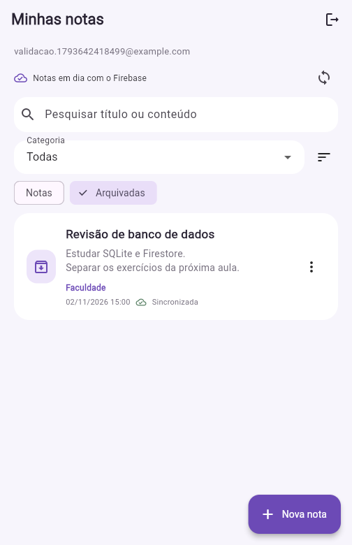
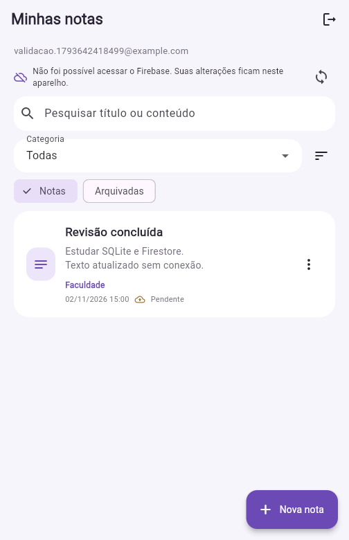
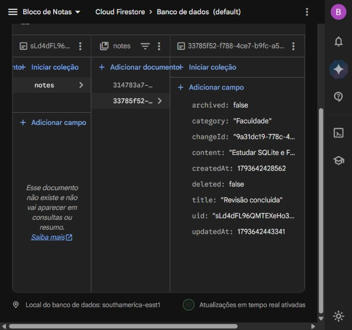
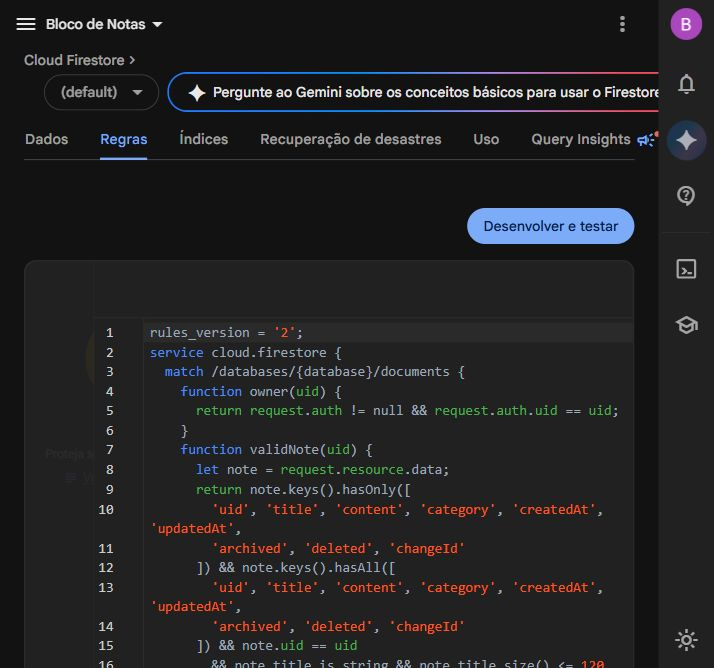

# Bloco de Notas

Aplicativo para guardar anotações, separar por categoria e continuar usando as mesmas notas em outra instalação. O SQLite mantém os dados no aparelho e o Cloud Firestore guarda uma cópia na conta do usuário.

O projeto parte do [bloco de notas da turma B](https://github.com/LopesBrendinha/bloco_de_nota_turma_B). Foram mantidas as pastas `models`, `database`, `screens`, `services` e `widgets`, as telas de entrada e cadastro e o tema lilás usado em aula.

## Funcionalidades

- Cadastro e entrada com e-mail e senha pelo Firebase Authentication.
- Criação, consulta, edição e exclusão de notas no SQLite e no Firestore.
- Categorias iniciais: Estudos, Pessoal e Trabalho. Outras categorias podem ser criadas no editor.
- Pesquisa pelo título ou conteúdo, sem diferenciar maiúsculas e acentos.
- Filtro por categoria e ordenação pela criação ou pela última atualização.
- Arquivamento e desarquivamento, sem apagar a nota.
- Indicação de notas sincronizadas e alterações pendentes.
- Sincronização na entrada, depois de alterar uma nota, ao voltar ao aplicativo, a cada 30 segundos e pelo botão de sincronizar.
- Recuperação das notas da conta em um banco local vazio.
- Preservação das notas antigas ao atualizar o banco SQLite da versão 1 para a 2.

Os recursos adicionais escolhidos foram **arquivamento** e **ordenação por data**. Ambos alteram o comportamento e os dados do aplicativo.

## Tecnologias

| Tecnologia | Uso no projeto |
| --- | --- |
| Flutter e Dart | Interface, validação e serviços |
| `sqflite` e `path` | Banco SQLite no Android e iOS |
| `sqflite_common_ffi_web` | SQLite com WebAssembly e persistência em IndexedDB no navegador |
| `firebase_core` | Inicialização do Firebase |
| `firebase_auth` | Cadastro, entrada e sessão do usuário |
| `cloud_firestore` | Armazenamento na nuvem e transações de sincronização |
| `uuid` | Identificadores das notas e de cada alteração |
| `diacritic` | Pesquisa sem diferenciação de acentos |
| `flutter_test`, `integration_test` e `sqflite_common_ffi` | Testes do banco, sincronização e aplicativo completo |
| Firebase CLI e `@firebase/rules-unit-testing` | Emuladores e testes das regras de segurança |

As dependências Dart estão em `pubspec.yaml` e suas versões resolvidas em `pubspec.lock`. As ferramentas de teste do Firebase estão em `package.json` e `package-lock.json`; elas não fazem parte do aplicativo instalado.

## Preparar o ambiente

O projeto foi desenvolvido com Flutter **3.47.6**, Dart **3.13.5**, Node.js e Java 21 ou superior para os emuladores. O `pubspec.yaml` exige Dart 3.12.2 ou superior, dentro da versão 3.

```sh
git clone https://github.com/Bulletzzz/bloco_de_nota_turma_B.git
cd bloco_de_nota_turma_B
git switch codex/melhorias-bloco-notas
flutter pub get
flutter doctor
```

Para Android, instale o SDK pelo Android Studio e configure um emulador ou conecte um aparelho com depuração USB. O Gradle pode baixar componentes do SDK e o NDK na primeira compilação. Para iOS, é necessário macOS, Xcode e a configuração de um app iOS no Firebase.

Para executar no navegador, os arquivos `web/sqlite3.wasm` e `web/sqflite_sw.js` já acompanham esta branch. Eles são gerados pela dependência de SQLite. Se atualizar essa dependência, gere os arquivos novamente:

```sh
dart run sqflite_common_ffi_web:setup --force
```

## Configurar o Firebase

1. Crie seu projeto no [console do Firebase](https://console.firebase.google.com/).
2. Em **Authentication → Método de login**, ative **E-mail/senha**.
3. Crie um banco **Cloud Firestore**, edição Standard, no modo nativo. Escolha a região antes de criar o banco.
4. Cadastre um aplicativo Web. Para Android, cadastre também o pacote `com.example.blocodenotasturmab`.
5. Copie `firebase.example.json` para `firebase.local.json` e preencha os campos com a configuração do aplicativo Web, disponível em **Configurações do projeto → Seus aplicativos**.
6. Para Android, crie `firebase.android.local.json` com os mesmos nomes de campos, usando a configuração do app Android. No `google-services.json`, a chave é `api_key.current_key`, o app ID é `client_info.mobilesdk_app_id` e o sender ID é `project_info.project_number`.

Os nomes de configuração usados pelo aplicativo são:

| Campo | Valor da configuração Firebase |
| --- | --- |
| `FIREBASE_API_KEY` | `apiKey` |
| `FIREBASE_APP_ID` | `appId` da plataforma escolhida |
| `FIREBASE_MESSAGING_SENDER_ID` | `messagingSenderId` |
| `FIREBASE_PROJECT_ID` | `projectId` |
| `FIREBASE_AUTH_DOMAIN` | `authDomain`, para Web |

O aplicativo recebe esses valores por `--dart-define-from-file`. Não depende da configuração do projeto da professora. A inicialização explícita pelo Dart também dispensa o plugin Gradle do Google Services.

Instale as ferramentas e publique as regras no **seu** projeto:

```sh
npm install
npx firebase login
npx firebase deploy --only firestore --project SEU_PROJECT_ID
```

No PowerShell, se a política de execução bloquear `npm` ou `npx`, use `npm.cmd` e `npx.cmd`. Outra opção é chamar o Firebase instalado na própria pasta:

```powershell
.\node_modules\.bin\firebase.cmd login
.\node_modules\.bin\firebase.cmd deploy --only firestore --project SEU_PROJECT_ID
```

Os arquivos `firebase.local.json`, `firebase.*.local.json`, `.firebaserc`, arquivos de serviço, chaves de assinatura e configurações nativas do Firebase estão no `.gitignore`. A configuração pública de cliente identifica o app; a autorização dos dados é feita pelo Authentication e pelas regras. Não coloque credenciais administrativas, senhas ou tokens nos arquivos de configuração ou no repositório.

## Executar

Web:

```sh
flutter run -d chrome --web-port=7357 --dart-define-from-file=firebase.local.json
```

Use sempre a mesma porta durante o desenvolvimento. O armazenamento do navegador pertence à combinação de protocolo, endereço e porta; trocar a porta cria outro armazenamento local.

Android:

```sh
flutter run -d ID_DO_DISPOSITIVO --dart-define-from-file=firebase.android.local.json
flutter build apk --debug --dart-define-from-file=firebase.android.local.json
```

O APK fica em `build/app/outputs/flutter-apk/app-debug.apk`. O build de depuração serve para avaliação e testes; uma distribuição pública precisa de assinatura própria.

Para iOS, registre o bundle ID do projeto, configure o app iOS e crie um arquivo local com o app ID dessa plataforma. Essa plataforma requer validação em um Mac.

## Executar sem um projeto na nuvem

É possível testar tudo localmente com o Firebase Emulator Suite. Esses dados são de teste e **não comprovam armazenamento na nuvem**.

```sh
npm install
npm run emulators
```

Em outro terminal:

```sh
flutter run -d chrome --web-port=7357 --dart-define=USE_FIREBASE_EMULATORS=true
```

No emulador Android, acrescente `--dart-define=FIREBASE_EMULATOR_HOST=10.0.2.2`. O endereço padrão é `127.0.0.1`, com Authentication na porta 9099 e Firestore na 8080. O painel dos emuladores fica em `http://127.0.0.1:4000`.

## Organização e padrões usados

```text
lib/
  main.dart                       inicialização, tema e acompanhamento da sessão
  firebase_options.dart           configuração por variáveis de compilação
  models/note.dart                modelo e conversão entre SQLite e Firestore
  database/database_helper.dart   criação, migração e consultas do SQLite
  screens/
    login_page.dart               entrada
    register_page.dart            cadastro
    notes_page.dart               listagem, pesquisa, filtros e arquivo
    note_form_page.dart           editor e criação de categorias
  services/
    auth_service.dart             operações e mensagens de autenticação
    firestore_service.dart        leitura e envio por transação ao Firestore
    sync_service.dart             coordenação da fila local e novas tentativas
  widgets/note_card.dart           apresentação e ações de uma nota
firestore.rules                   isolamento e validação dos documentos
test/                             testes do SQLite, sincronização e regras
integration_test/                 teste completo com SQLite e Firebase reais
test_driver/                      execução no Chrome e geração das capturas
docs/                             capturas e registro de validação
```

O projeto usa separação entre telas, dados e serviços, sem trocar a estrutura do exercício por um framework de arquitetura.

- **DAO:** `DatabaseHelper` concentra o SQL. As telas não montam consultas nem acessam tabelas diretamente.
- **Singleton:** `DatabaseHelper.instance` compartilha uma conexão no aplicativo. O construtor também aceita outro banco e outra fábrica para testar migrações e simular uma nova instalação.
- **Observer:** `SyncService` usa `ChangeNotifier`; a tela acompanha o início e o fim da sincronização. `AuthGate` acompanha `authStateChanges` para reconstruir a tela quando a conta muda.
- **Inversão de dependência:** `SyncService` recebe um `NotesCloud`. O app usa `FirestoreService`; os testes do algoritmo usam uma implementação em memória, inclusive para provocar falhas de conexão e edições durante o envio.
- **Factory constructors:** `Note.fromMap` e `Note.fromCloud` fazem a conversão dos formatos de cada armazenamento em um único modelo.

## Armazenamento e sincronização

Cada nota tem um `id` numérico, usado somente no SQLite, e um `cloudId` UUID, compartilhado entre as instalações. No Firestore, o caminho é:

```text
users/{uid}/notes/{cloudId}
```

O `uid` sempre vem da sessão autenticada. A categoria é guardada junto da nota; assim, uma categoria criada no editor também aparece em outra instalação quando a nota é recuperada. Categorias sem notas não são mantidas como cadastros independentes.

Ao salvar, editar, arquivar ou excluir:

1. O SQLite grava a alteração com `synced = 0`, um novo `changeId` e a data de atualização.
2. O serviço consulta as alterações pendentes da conta atual.
3. Cada nota é enviada por uma transação do Firestore. O documento é lido antes da gravação para comparar as versões.
4. A confirmação só limpa a pendência local se o `changeId` ainda for o mesmo. Uma edição feita enquanto o envio está acontecendo continua pendente.
5. Depois dos envios, o serviço consulta o servidor e importa as notas da conta para o SQLite. Uma resposta antiga não substitui uma versão local mais recente nem uma edição pendente.

As versões são comparadas por `updatedAt`, em milissegundos. A alteração mais recente vence; se os horários forem iguais, `changeId` desempata de forma determinística. Isso depende do relógio dos aparelhos e não une dois textos editados simultaneamente. Para este aplicativo, o conflito é resolvido por nota inteira.

Uma exclusão limpa o título e o conteúdo e mantém um pequeno registro com `deleted = true` nos dois bancos. Esse marcador evita que uma cópia antiga volte a aparecer depois de sincronizar. Ele não é uma lixeira e não oferece recuperação do texto apagado. As consultas normais não mostram notas excluídas; uma exclusão física direta no Firestore é bloqueada pelas regras.

Na atualização da versão 1, o banco recebe os novos campos sem apagar as notas. As notas existentes ganham UUIDs, categoria Pessoal e estado pendente para o primeiro envio. A data anterior é aproveitada quando está no formato usado pelo projeto original.

## Conexão, autenticação e segurança

As telas leem o SQLite, inclusive durante uma falha de conexão. O cadastro e uma nova entrada exigem internet; uma sessão já preservada pelo Firebase permite continuar acessando o conteúdo local da conta. Após sair, é necessário autenticar novamente.

Uma falha do Firebase mantém a pendência gravada no SQLite. O serviço informa o problema e tenta de novo a cada 30 segundos, ao retomar o app ou pelo botão de sincronizar. As chamadas têm limite de tempo. Um aviso de acesso negado orienta a verificar as regras. O aplicativo não usa o cache do Firestore como substituto da fila SQLite; a consulta de recuperação pede explicitamente dados do servidor.

Ao sair com alterações pendentes, o app avisa que elas continuam somente naquele aparelho até a próxima entrada e sincronização. A troca de conta interrompe a aplicação das respostas da sessão anterior. Todas as consultas e alterações locais incluem o dono da nota.

Em `firestore.rules`, a leitura e a gravação exigem `request.auth.uid == uid` do caminho. As regras conferem o dono do documento, os tipos, os campos permitidos, o tamanho de título/conteúdo/categoria e a preservação da data de criação. As regras precisam estar publicadas; proteger apenas a interface não protege o banco.

O SQLite não é criptografado. O isolamento local é feito pelas consultas por usuário, e o armazenamento continua sujeito à proteção do próprio aparelho ou perfil do navegador.

## Testes

```sh
flutter analyze
flutter test
npm run test:rules
```

Os testes Dart verificam pesquisa, filtros, isolamento, arquivo, ordenação, migração, falha de conexão, persistência da fila, conflitos e edição durante o envio. Os testes das regras usam o Firestore Emulator para conferir o acesso do dono, de outra conta e de um visitante, além de documentos inválidos.

O teste de integração usa o aplicativo completo com um SQLite persistente e os SDKs do Firebase. Verifica cadastro, categorias, pesquisa, arquivo, edição com comunicação indisponível, reenvio, outra instalação, novo login, exclusão e bloqueio entre contas. Para provocar a falha de forma reproduzível, uma implementação de `NotesCloud` interrompe temporariamente as chamadas e devolve o erro `unavailable`; depois, libera o envio ao Firestore real. Isso não desliga a rede do computador. Para executar no Chrome, inicie os emuladores e um ChromeDriver compatível com o Chrome na porta 4444:

```sh
chromedriver --port=4444
flutter drive --driver=test_driver/integration_test.dart --target=integration_test/app_test.dart -d web-server --web-port=7358 --headless --browser-dimension=430,932 --dart-define=USE_FIREBASE_EMULATORS=true
```

O teste gera capturas em `docs/screenshots`. Para validar um projeto real, troque o último parâmetro por `--dart-define-from-file=firebase.local.json --dart-define=CLOUD_EVIDENCE=true`. Essa opção cria contas de teste com endereços `@example.com`, senhas aleatórias em memória e notas de validação no projeto configurado. A nota principal permanece disponível para conferir as evidências.

## Capturas e evidências

As imagens com prefixo `nuvem-` foram obtidas executando o app contra o projeto Firebase do trabalho. As imagens com prefixo `emulador-` correspondem ao ambiente local de testes.

| Notas sincronizadas | Editor com categoria | Pesquisa por conteúdo |
| --- | --- | --- |
|  |  |  |

| Arquivamento | Alteração pendente sem conexão |
| --- | --- |
|  |  |





O registro das verificações e os caminhos das evidências estão em [docs/validacao.md](docs/validacao.md).

## Git e entrega

O desenvolvimento está na branch `codex/melhorias-bloco-notas` do [fork](https://github.com/Bulletzzz/bloco_de_nota_turma_B), com commits separados para sincronização, telas, testes e documentação. O destino do Pull Request é `main` de `LopesBrendinha/bloco_de_nota_turma_B`.

A entrega no Google Classroom é feita pelo aluno. Este projeto não envia a atividade automaticamente.

## Referências

- [Configuração do Firebase para Flutter](https://firebase.google.com/docs/flutter/setup)
- [Cloud Firestore para Flutter](https://firebase.google.com/docs/firestore/quickstart?platform=flutter)
- [Testes das regras de segurança](https://firebase.google.com/docs/firestore/security/test-rules-emulator)
- [Testes de integração do Flutter](https://docs.flutter.dev/testing/integration-tests)
- [SQLite no navegador](https://pub.dev/packages/sqflite_common_ffi_web)
