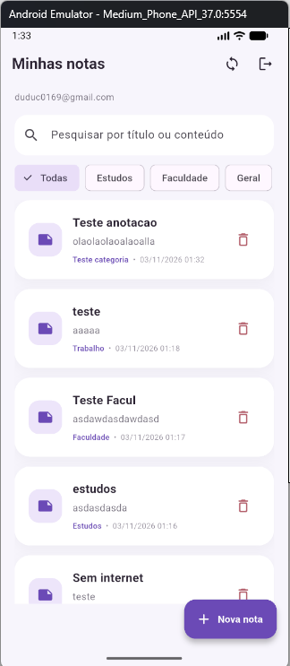
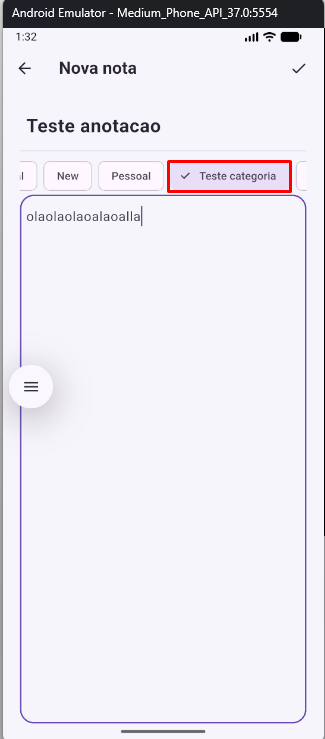
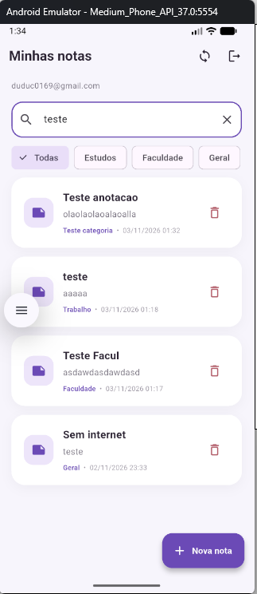
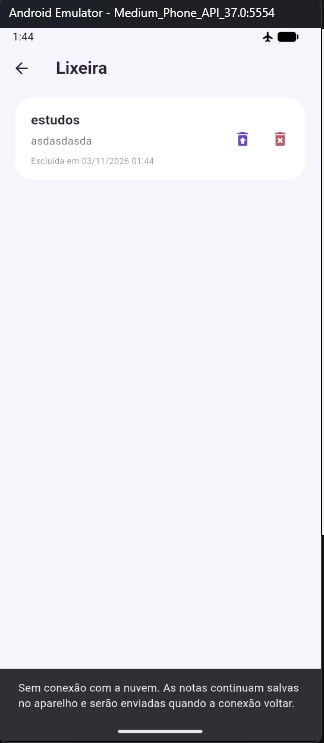
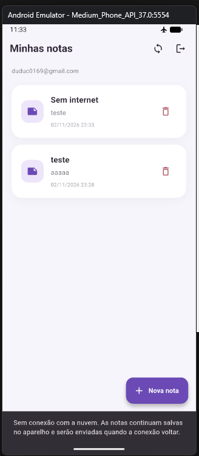
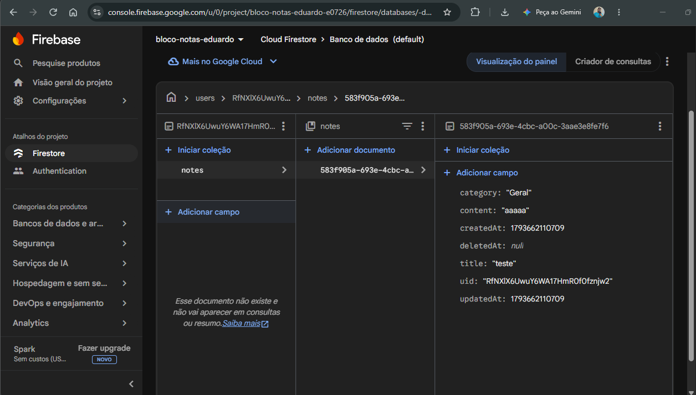
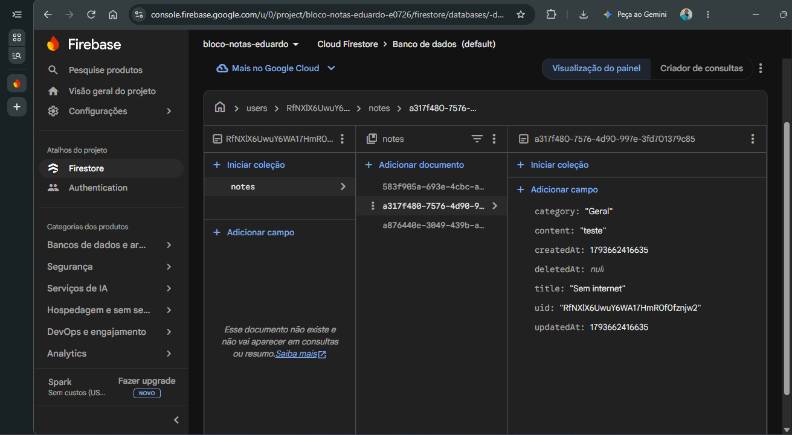
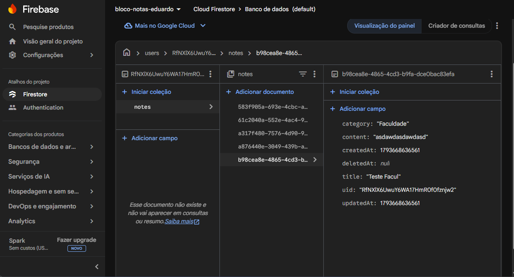

# Bloco de Notas (Flutter + SQLite + Firebase)

Aplicativo de bloco de notas em Flutter que guarda as notas no aparelho (SQLite) e as sincroniza com a nuvem (Cloud Firestore), associando cada nota ao usuário autenticado (Firebase Authentication). O app funciona sem internet: as alterações ficam salvas localmente e são enviadas quando a conexão volta.

Projeto desenvolvido a partir do repositório da professora, com as evoluções pedidas na atividade: integração com o Firebase, categorias, pesquisa, lixeira com recuperação e ordenação por data.

## Funcionalidades

- Cadastro e login com e-mail e senha (Firebase Authentication).
- Criar, consultar, editar e excluir notas, no banco local e na nuvem.
- Notas associadas ao usuário logado: cada pessoa vê somente as suas.
- Recuperação das notas ao entrar de novo ou em outra instalação.
- **Categorias:** Geral, Estudos, Trabalho e Pessoal já vêm prontas, e o usuário pode criar as suas. Cada nota tem uma categoria, mostrada no card.
- **Pesquisa** por título ou conteúdo, com filtro por categoria. Os dois funcionam juntos.
- **Lixeira com recuperação (funcionalidade adicional):** excluir move a nota para a lixeira, de onde ela pode ser restaurada ou excluída definitivamente.
- **Ordenação por data (funcionalidade adicional):** por última atualização ou por data de criação.
- Sincronização automática (ao abrir, ao salvar, ao excluir e ao restaurar) e botão de sincronização manual.
- Tratamento de erros de conexão, de permissão e de indisponibilidade do Firebase, com mensagens claras.

## Tecnologias e dependências

| Tecnologia | Uso |
|---|---|
| Flutter / Dart | Aplicativo (alvo testado: Android) |
| `sqflite` e `path` | Banco de dados local (SQLite) |
| `firebase_core` | Inicialização do Firebase |
| `firebase_auth` | Autenticação por e-mail e senha |
| `cloud_firestore` | Armazenamento das notas na nuvem |
| `uuid` | Geração do identificador único de cada nota |

As versões exatas estão no `pubspec.yaml`.

> **Plataforma:** o `sqflite` funciona em Android e iOS. Ele não roda no navegador nem no Windows sem pacotes adicionais, por isso o app deve ser executado em um emulador ou celular Android.

## Como instalar e executar

1. Instale o [Flutter](https://docs.flutter.dev/get-started/install) e o Android Studio (com o Android SDK, o NDK e as Command-line Tools).
2. Clone o repositório e entre na pasta:
   ```bash
   git clone https://github.com/edugab08/bloco_de_nota_turma_B.git
   cd bloco_de_nota_turma_B
   git checkout melhorias-bloco-notas
   ```
3. Instale as dependências:
   ```bash
   flutter pub get
   ```
4. **Configure o Firebase** (seção abaixo).
5. Ligue um emulador Android (ou conecte um celular com depuração USB) e confira se ele aparece:
   ```bash
   flutter devices
   ```
6. Execute:
   ```bash
   flutter run -d <id-do-dispositivo>
   ```

## Como configurar o Firebase

Os arquivos de configuração do Firebase (`lib/firebase_options.dart`, `android/app/google-services.json` e `firebase.json`) identificam **um projeto Firebase específico**. Os que estão no repositório vêm do projeto do código original. Para usar o seu próprio projeto, siga os passos abaixo. Esses arquivos gerados para o seu projeto **não devem ser enviados ao repositório**.

1. Em [console.firebase.google.com](https://console.firebase.google.com), crie um projeto (o Google Analytics pode ficar desativado).
2. Em **Authentication > Método de login**, ative **E-mail/senha**.
3. Em **Firestore Database**, crie o banco (modo produção). Sugestão de região: `southamerica-east1` (São Paulo).
4. Em **Firestore Database > Regras**, cole o conteúdo do arquivo [`firestore.rules`](firestore.rules) deste repositório e clique em **Publicar**. Sem essas regras, o Firestore bloqueia todo acesso e a sincronização falha com "permission-denied".
5. Instale as ferramentas e gere a configuração do app (precisa do Node.js):
   ```bash
   npm install -g firebase-tools
   firebase login
   dart pub global activate flutterfire_cli
   dart pub global run flutterfire_cli:flutterfire configure
   ```
   Escolha o seu projeto e marque a plataforma **android**. Responda **não** à pergunta sobre reaproveitar o `firebase.json` existente, e **sim** para sobrescrever o `firebase_options.dart`. Isso substitui os arquivos de configuração pelos do seu projeto.

## Arquitetura e organização dos arquivos

O app tem três camadas: telas (interface), serviços (regras de acesso e sincronização) e dados (modelo e banco local).

```
lib/
├── main.dart                     Inicialização do Firebase e tema do app
├── firebase_options.dart         Configuração do projeto Firebase (gerada pelo FlutterFire)
├── models/
│   └── note.dart                 Modelo Note (conversões para SQLite e Firestore)
├── database/
│   └── database_helper.dart      Banco local (SQLite): notas e categorias
├── services/
│   ├── auth_service.dart         Login, cadastro e logout (Firebase Auth)
│   ├── firestore_service.dart    Acesso ao Cloud Firestore
│   └── sync_service.dart         Sincronização entre SQLite e Firestore
├── screens/
│   ├── login_page.dart           Tela de login
│   ├── register_page.dart        Tela de cadastro
│   ├── notes_page.dart           Lista, pesquisa, filtro, ordenação e sincronização
│   ├── note_form_page.dart       Criar/editar nota e escolher categoria
│   └── trash_page.dart           Lixeira
└── widgets/
    └── note_card.dart            Card de uma nota na lista
firestore.rules                   Regras de segurança do Firestore
```

Fluxo de dados: as **telas** nunca falam com o Firestore diretamente. Elas leem e gravam no SQLite (`DatabaseHelper`) e pedem ao `SyncService` para sincronizar. O `SyncService` usa o `FirestoreService` para conversar com a nuvem.

## Padrões de projeto adotados

- **Singleton** — `DatabaseHelper.instance` (`database_helper.dart`). Garante uma única conexão aberta com o SQLite em todo o app, em vez de abrir um banco por tela.
- **Camada de serviços** — `AuthService`, `FirestoreService` e `SyncService` (`lib/services/`). Cada um tem uma responsabilidade: autenticação, acesso à nuvem e sincronização. As telas ficam sem lógica de rede, e trocar o backend mexeria só nos serviços.
- **Injeção de dependência pelo construtor** — o `SyncService` recebe o `DatabaseHelper` e o `FirestoreService` pelo construtor (com valores padrão). Isso separa as responsabilidades e permitiria trocar as implementações em testes.
- **Objeto de valor imutável com `copyWith`** — `Note` (`note.dart`). Os campos são `final`, e cada alteração (editar, mover para a lixeira, restaurar) cria uma nova nota com `copyWith`, o que evita alterações acidentais. O modelo também centraliza a conversão para SQLite (`toMap`/`fromMap`) e para o Firestore (`toFirestore`/`fromFirestore`).
- **Local-first (offline-first)** — o SQLite é a fonte que a interface sempre lê e grava. A nuvem é sincronizada em segundo plano. O app continua utilizável sem internet.
- **Exclusão lógica (soft delete)** — o campo `deletedAt` marca a nota como excluída sem apagá-la. É o que permite a lixeira e faz a exclusão se propagar para os outros aparelhos pela sincronização normal.

## Armazenamento local e integração com o Firebase

**SQLite (local).** Banco `notes.db`, versão 2, com duas tabelas:

- `notes`: `id` (UUID), `uid` (dono), `title`, `content`, `category`, `createdAt`, `updatedAt`, `deletedAt` e `synced`.
- `categories`: `uid` e `name` (chave composta).

Todas as consultas filtram por `uid`, então dois usuários no mesmo aparelho não veem as notas um do outro. A pesquisa usa `LIKE` em título e conteúdo, combinada com o filtro de categoria e a ordenação escolhida.

**Cloud Firestore (nuvem).** As notas ficam em `users/{uid}/notes/{id da nota}`, com os mesmos campos do SQLite, exceto `synced`, que só tem sentido localmente. O ID da nota é um **UUID gerado no aparelho** e é o mesmo nas duas bases. Isso permite criar notas offline sem conflito de IDs e saber que a nota local e o documento da nuvem são a mesma.

## Estratégia de sincronização e tratamento de erros

Toda alteração é gravada primeiro no SQLite com `synced = false`. O `SyncService.sync` roda ao abrir a lista, depois de salvar, excluir ou restaurar, e no botão de sincronizar. Ele executa quatro passos:

1. **Lê** o estado atual da nuvem e do aparelho.
2. **Envia** as notas pendentes (`synced = false`). Se a versão da nuvem for mais recente, ela vence e a local não é enviada.
3. **Remove** do aparelho as notas já sincronizadas que não existem mais na nuvem (excluídas definitivamente em outro aparelho).
4. **Baixa** as notas novas ou com `updatedAt` mais recente que a cópia local, e recria as categorias delas.

**Conflitos:** quando a mesma nota é alterada em dois lugares, vence a de `updatedAt` mais recente ("a última alteração vence").

**Lixeira:** mover para a lixeira e restaurar são alterações comuns (mudam o `deletedAt`) e sincronizam como qualquer outra. A **exclusão definitiva** apaga primeiro o documento na nuvem e depois a cópia local. Sem conexão ela não é feita (a nota continua na lixeira com um aviso), porque apagar só localmente faria a nota voltar na próxima sincronização.

**Erros tratados:**

| Situação | Comportamento |
|---|---|
| Sem internet ou nuvem indisponível (timeout de 10 s ou `unavailable`) | Aviso na tela. As notas continuam salvas no aparelho como pendentes e são enviadas na próxima sincronização. |
| Sem permissão (`permission-denied`) | Aviso indicando para verificar as regras do Firestore e o login. |
| Outro erro do Firebase | Aviso com o código do erro. |
| Erro inesperado | Aviso informando que as notas locais estão seguras. |

A leitura da nuvem é sempre feita no servidor (`Source.server`), para que, sem conexão, o app não use uma cópia antiga do cache do Firestore como se fosse o estado real.

## Autenticação e segurança dos dados

- A autenticação é por e-mail e senha (Firebase Authentication). As notas só são lidas e gravadas com um usuário logado, e cada nota guarda o `uid` do dono.
- **Regras do Firestore** (`firestore.rules`): o usuário só lê, cria, altera e apaga documentos em `users/{o próprio uid}/notes/...`. Ao gravar, o documento precisa ter `uid` igual ao do usuário logado e `title` e `content` do tipo texto. Qualquer outro caminho é negado.
- As chaves que ficam nos arquivos de configuração do Firebase identificam o app e não dão acesso aos dados por si só: quem protege os dados são as regras acima e a autenticação.
- Nenhuma senha, chave privada ou credencial de serviço está no repositório.

## Capturas de tela

### Aplicativo

| Lista de notas | Formulário com categorias |
|---|---|
|  |  |

| Pesquisa e filtro | Lixeira |
|---|---|
|  |  |

| Ordenação | Aviso sem conexão |
|---|---|
|  |  |

### Evidências no Firebase

Usuário cadastrado no Firebase Authentication:


Notas armazenadas no Cloud Firestore (`users/{uid}/notes`), com título, conteúdo, categoria, datas e `uid`:



Nota criada sem internet que aparece no Firestore depois que a conexão voltou:



Nota com categoria criada pelo usuário:



Regras de segurança publicadas:


## Limitações conhecidas

- A pesquisa usa `LIKE` do SQLite: ignora maiúsculas e minúsculas, mas não diferencia acentos (buscar "acao" não encontra "ação").
- Em conflito, a comparação de `updatedAt` usa o relógio de cada aparelho.
- A exclusão definitiva exige conexão com a internet.
- Categorias podem ser criadas, mas não renomeadas nem excluídas.
- O banco local não é criptografado.
- O app foi testado em emulador Android.
