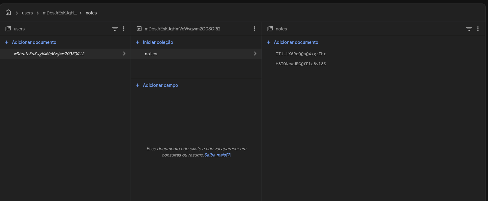
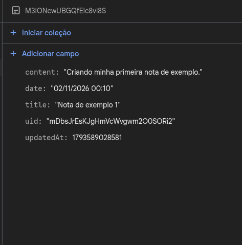
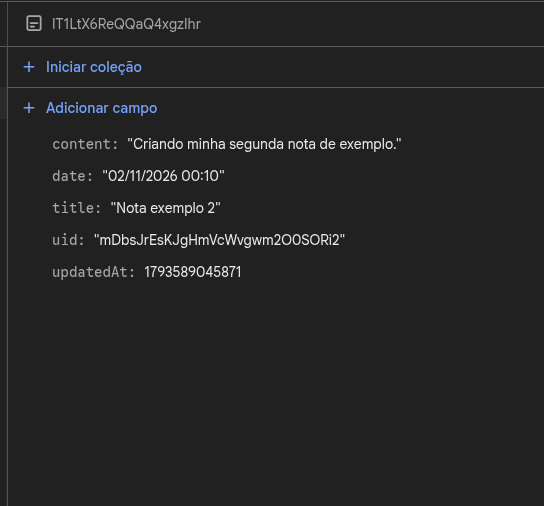

# Bloco de Notas - Turma B

Aplicativo Android em Flutter para criar e organizar notas pessoais, com ou sem internet.

O projeto base já tinha login, cadastro e notas salvas no aparelho. Após o fork, foram adicionadas a sincronização com a nuvem, as categorias, a pesquisa e a marcação de notas concluídas.

## Alterações após o fork

| Alteração | Arquivos | Como foi feita |
|---|---|---|
| Integração com o Firestore | `services/firestore_service.dart`, `models/note.dart` | O serviço salva, busca e exclui notas em `users/{uid}/notes`. O modelo ganhou conversões para o formato do Firestore. |
| Regras de segurança | `firestore.rules` | Cada usuário só acessa as próprias notas. |
| Sincronização | `repositories/note_repository.dart`, `database/database_helper.dart` | A nota é salva primeiro no SQLite e depois enviada ao Firestore. As colunas `remote_id`, `synced` e `deleted` controlam o que falta enviar. |
| Categorias | `screens/note_form_page.dart`, `repositories/note_repository.dart` | O formulário permite escolher uma categoria padrão ou criar uma nova. |
| Pesquisa | `screens/notes_page.dart` | A lista é filtrada por título e conteúdo, ignorando maiúsculas e acentos. |
| Notas concluídas | `widgets/note_card.dart`, `screens/notes_page.dart`, `models/note.dart` | Um `Checkbox` altera o campo `completed` e o título da nota fica riscado. |

## Padrão seguido

O principal padrão adotado foi o **Repository**, no `NoteRepository`.

As telas pedem para salvar, excluir ou sincronizar notas, sem saber se os dados estão no SQLite ou no Firestore. Isso deixa a regra de sincronização em um único lugar.

```text
Telas -> NoteRepository -> DatabaseHelper (SQLite)
                        -> FirestoreService (Firestore)
```

O projeto manteve a separação já existente em pastas: `models`, `database`, `services`, `screens` e `widgets`. A pasta `repositories` foi adicionada.

## Sincronização e erros

- **Ao salvar ou excluir:** a alteração vai para o SQLite como pendente e o app tenta enviá-la ao Firestore. Se o envio falhar, ela continua pendente e o usuário vê um aviso.
- **Ao sincronizar:** o app envia as pendências e depois baixa as notas da nuvem. Isso acontece ao abrir a lista, ao tocar em **Sincronizar** ou ao arrastar a lista para baixo.
- **Conflitos:** alterações pendentes não são sobrescritas pelo download. A última versão enviada é a que fica na nuvem.
- **Erros:** `FirebaseException` e o limite de 10 segundos (`TimeoutException`) são tratados no repositório. Se a sincronização falhar, a lista mostra as notas locais com um aviso de offline.

## Tecnologias

Flutter, Dart, Firebase Authentication, Cloud Firestore e SQLite (`sqflite`).

## Como executar

Com o Flutter e o Android SDK instalados e um celular ou emulador Android conectado:

```bash
git clone https://github.com/Alan-pereiraa/bloco_de_nota_turma_B.git
cd bloco_de_nota_turma_B
flutter pub get
flutter run
```

A versão Web não funciona, porque o `sqflite` não tem suporte a navegador.

## Como configurar o Firebase

O repositório já vem configurado. Para usar outro projeto:

1. No [Console do Firebase](https://console.firebase.google.com/), crie o projeto, ative o login por **E-mail/senha** e crie o **Firestore Database**.
2. Conecte o app e publique as regras, trocando `SEU_PROJETO` pelo ID do projeto:

```bash
npm install -g firebase-tools
firebase login
dart pub global activate flutterfire_cli
flutterfire configure
firebase deploy --only firestore:rules --project SEU_PROJETO
```

## Autenticação e segurança

- O login usa e-mail e senha pelo Firebase Authentication.
- No Firestore, as regras limitam cada usuário aos próprios dados. No SQLite, as consultas filtram pelo `uid`.
- `firebase_options.dart` e `google-services.json` identificam o app no Firebase e não dão acesso administrativo.
- O repositório não contém chaves de conta de serviço nem arquivos `.env`.

## Capturas de tela

### Evidências no Firebase

Notas do usuário salvas no caminho `users/{uid}/notes`:



Campos de cada nota no Firestore:




