# Bloco de Notas

Aplicativo Flutter de notas com login, que funciona sem internet e guarda uma
cópia de tudo na nuvem. As notas ficam em um banco **SQLite** no aparelho e são
sincronizadas com o **Cloud Firestore**, então o usuário as recupera ao entrar
em outra instalação.

Este projeto evolui o [bloco de notas da turma B](https://github.com/LopesBrendinha/bloco_de_nota_turma_B).

## Funcionalidades

- **Conta de usuário:** cadastro, login e logout com e-mail e senha. A sessão
  fica salva, inclusive para abrir o aplicativo sem internet.
- **Notas:** criar, consultar, editar e excluir, no SQLite e no Firestore.
- **Sincronização:** as alterações sobem e descem sozinhas. O status aparece na
  tela de notas, e arrastar a lista para baixo força uma nova sincronização.
- **Modo sem internet:** tudo continua funcionando. O que não foi enviado fica
  pendente e sobe quando a conexão voltar.
- **Categorias:** Estudos, Trabalho e Pessoal já vêm prontas, e o usuário pode
  criar e excluir as próprias. Cada nota pode ter uma categoria.
- **Pesquisa:** por título e conteúdo, sem diferenciar maiúsculas nem acentos.
  Pode ser combinada com o filtro de categoria.
- **Funcionalidade adicional, lixeira com recuperação:** a nota excluída vai
  para a lixeira, de onde pode ser recuperada ou apagada de vez. A lixeira
  também é sincronizada.

## Tecnologias

| Tecnologia | Uso |
| --- | --- |
| Flutter e Dart (`^3.12.2`) | Interface e regras do aplicativo |
| `sqflite` | Banco local SQLite |
| `firebase_core` | Inicialização do Firebase |
| `firebase_auth` | Autenticação por e-mail e senha |
| `cloud_firestore` | Armazenamento na nuvem |
| `path` | Caminho do arquivo do banco |
| `flutter_test`, `sqflite_common_ffi` | Testes automatizados com SQLite real |

## Como executar

Você precisa do [Flutter](https://docs.flutter.dev/get-started/install) e de um
emulador Android ou celular. O repositório está configurado e testado para
**Android**. Para usar no iOS, rode `flutterfire configure` incluindo essa
plataforma. O aplicativo não funciona na web, porque o `sqflite` não tem suporte a ela.

```bash
git clone <url-do-seu-fork>
cd bloco_de_nota_turma_B
git checkout desenvolvimento
flutter pub get
flutter run
```

O repositório já está ligado ao projeto Firebase `bloco-de-notas-36ede`. Para
usar um projeto próprio, siga a próxima seção antes do `flutter run`.

Para rodar os testes:

```bash
flutter test
```

## Como configurar o Firebase

1. No [console do Firebase](https://console.firebase.google.com), crie um projeto.
2. Em **Authentication**, ative o provedor **E-mail/senha**.
3. Em **Firestore Database**, crie o banco em modo de produção.
4. Gere os arquivos de configuração do aplicativo:

   ```bash
   npm install -g firebase-tools
   firebase login
   dart pub global activate flutterfire_cli
   flutterfire configure --project=<id-do-projeto> --platforms=android
   ```

   Esse comando atualiza `lib/firebase_options.dart` e
   `android/app/google-services.json`.
5. Publique as regras de segurança:

   ```bash
   firebase deploy --only firestore:rules --project <id-do-projeto>
   ```

   Outra opção é colar o conteúdo de `firestore.rules` na aba **Regras** do
   Firestore e clicar em **Publicar**.

## Arquitetura

O aplicativo é *offline-first*: as telas só falam com o repositório, e o
repositório sempre lê e grava no SQLite. A nuvem é atualizada em segundo plano.

```
lib/
├── main.dart                  Cria as dependências e inicia o aplicativo
├── firebase_options.dart      Configuração gerada pelo FlutterFire
├── database/
│   └── database_helper.dart   Todo o SQL, as tabelas e a migração
├── models/
│   ├── note.dart              Nota e conversões para SQLite e Firestore
│   ├── note_category.dart     Categoria e categorias padrão
│   ├── syncable.dart          Contrato dos registros sincronizados
│   └── sync_status.dart       Situação exibida ao usuário
├── repositories/
│   └── notes_repository.dart  Porta de entrada das telas para os dados
├── services/
│   ├── auth_service.dart          Firebase Authentication
│   ├── remote_data_source.dart    Interface da nuvem e tipos de erro
│   ├── firestore_data_source.dart Implementação com Firestore
│   ├── sync_planner.dart          Decide o destino de cada registro
│   └── sync_service.dart          Executa a sincronização
├── screens/                   Telas
├── utils/                     Datas, IDs e normalização de texto
└── widgets/                   Componentes reutilizáveis
firestore.rules                Regras de segurança do Firestore
test/                          Testes automatizados
```

Fluxo de uma nota salva:

```
Tela → NotesRepository → SQLite (gravado na hora)
                  └────→ SyncService → FirestoreDataSource → Firestore
                         (em segundo plano, cerca de 1 segundo depois)
```

## Padrões de projeto

| Padrão | Onde | Por quê |
| --- | --- | --- |
| **Repository** | `NotesRepository` | Esconde das telas de onde os dados vêm. Elas não conhecem SQL nem Firestore. |
| **DAO** | `DatabaseHelper` | Concentra o SQL em uma classe. Mudar uma tabela não afeta as telas. |
| **Adapter** | `FirestoreDataSource` | Adapta o SDK do Firestore à interface `RemoteDataSource` e traduz seus erros para `RemoteException`. |
| **Observer** | `NotesRepository` (`ChangeNotifier`) e `AuthGate` | As telas recarregam quando os dados mudam, e o `AuthGate` reage à entrada e à saída do usuário. |
| **Injeção de dependência** | `main.dart` | As classes recebem as dependências pelo construtor. Assim, os testes trocam o Firestore por uma nuvem falsa e usam um SQLite temporário. |

## Armazenamento local

O SQLite tem três tabelas:

- **`notes`:** as notas, com `category_id`, datas em milissegundos, `trashed_at`
  para a lixeira, `synced_at` para a sincronização e `search_text` para a pesquisa.
- **`categories`:** as categorias criadas pelo usuário.
- **`pending_deletions`:** exclusões que ainda precisam ser repetidas na nuvem.

O banco passou da versão 1 para a 2. A migração em `DatabaseHelper._upgrade`
roda em uma transação e preserva as notas existentes.

O ID passou de `AUTOINCREMENT` para **UUID** porque dois aparelhos gerariam o
mesmo número para notas diferentes. Com o UUID, a nota tem o mesmo ID no SQLite
e no Firestore desde a criação, mesmo sem internet.

A coluna `search_text` guarda título e conteúdo em minúsculas e sem acentos.
Ela é necessária porque o `LOWER()` do SQLite só trata letras ASCII: sem ela,
pesquisar `reuniao` não encontraria `REUNIÃO`.

## Integração com o Firebase

Cada usuário tem os próprios dados no Firestore:

```
users/{uid}/notes/{noteId}
    uid, title, content, categoryId, createdAt, updatedAt,
    trashedAt, serverUpdatedAt

users/{uid}/categories/{categoryId}
    uid, name, updatedAt, serverUpdatedAt
```

As categorias padrão ficam no código, com IDs fixos, e por isso são iguais em
todos os aparelhos.

O cache do Firestore está desligado em `main.dart`. Com ele ligado, uma nota
salva sem internet pareceria enviada sem ter chegado à nuvem, e existiriam duas
filas de escrita. O SQLite é o único armazenamento offline.

## Estratégia de sincronização

Cada registro guarda dois valores: `updated_at`, de quando mudou, e `synced_at`,
com o valor de `updated_at` na última vez que ficou igual à nuvem. Se forem
diferentes, ou se `synced_at` for nulo, há uma alteração pendente.

Cada rodada, em `SyncService`, segue esta ordem:

1. **Lê tudo da nuvem.** Sem conexão, para aqui, sem esperar a cada envio.
2. **Envia as exclusões** da tabela `pending_deletions`.
3. **Compara os dois lados** com `planSync` e atualiza o SQLite.
4. **Envia para a nuvem** o que ficou pendente.

A decisão de `planSync` é esta:

| Situação | Ação |
| --- | --- |
| Existe só na nuvem | Baixa para o aparelho |
| Existe só no aparelho e nunca foi enviado | Envia para a nuvem |
| Mudou só na nuvem | Atualiza o aparelho |
| Mudou só no aparelho | Atualiza a nuvem |
| Mudou nos dois lados | Vence o `updatedAt` mais recente (*last write wins*) |
| Sumiu da nuvem, sem alteração local | Foi apagado em outro aparelho e sai daqui |
| Sumiu da nuvem, com alteração local | É reenviado, para não perder o texto editado |

A sincronização roda ao entrar no aplicativo, cerca de 1 segundo depois de uma
alteração, ao voltar para o aplicativo, ao arrastar a lista para baixo e a cada
30 segundos enquanto houver pendências ou falta de conexão.

A nota na lixeira é apenas um campo `trashedAt` e continua no Firestore. A
exclusão definitiva apaga o documento.

**Limitação conhecida:** no conflito, a versão mais antiga é descartada, e a
comparação usa o relógio dos aparelhos. Se duas pessoas editarem a mesma nota
sem internet, ou se um relógio estiver errado, uma das edições pode se perder.

## Tratamento de erros

| Situação | Comportamento |
| --- | --- |
| Sem internet ou tempo esgotado (15 s) | A nota fica no SQLite como pendente, a tela avisa e o envio é repetido a cada 30 s |
| Conexão cai no meio do envio | O que já subiu fica marcado, e o resto continua pendente |
| Regras recusam uma nota | A tela avisa, as demais notas são enviadas e a nota recusada continua no aparelho |
| Sessão expirada ou limite do Firebase | A tela mostra uma mensagem específica, e as notas continuam no aparelho |
| Erro no login ou no cadastro | Mensagem específica, como falta de internet, senha incorreta ou e-mail em uso |

Uma falha nunca apaga dados locais. Em `sync_service_test.dart` há testes para
esses casos, com a nuvem falsa simulando cada erro.

## Autenticação e segurança

- O login usa o Firebase Authentication. O aplicativo nunca vê nem guarda a
  senha depois de enviá-la ao Firebase.
- No SQLite, toda consulta filtra por `uid`. Duas contas no mesmo aparelho não
  veem as notas uma da outra.
- As regras em `firestore.rules` são a proteção real, porque valem no servidor:
  - só o dono acessa `users/{uid}/...`, comparando `request.auth.uid` com o caminho;
  - o campo `uid` do documento precisa ser o do dono;
  - os campos, tipos e tamanhos são validados;
  - qualquer outro caminho é negado.
- `firebase_options.dart` e `google-services.json` trazem identificadores
  públicos do aplicativo, que vão dentro do app instalado. Eles não dão acesso
  aos dados, pois quem protege os dados são as regras e a autenticação.
- Senhas, chaves privadas e contas de serviço nunca entram no repositório. O
  `.gitignore` bloqueia `.env` e arquivos de conta de serviço.

## Testes

Os testes usam um SQLite real em arquivo temporário e uma nuvem falsa.

| Arquivo | O que cobre |
| --- | --- |
| `test/services/sync_planner_test.dart` | Cada regra de decisão da sincronização |
| `test/services/sync_service_test.dart` | Segunda instalação, falta de internet, permissão negada e conflitos |
| `test/database/database_helper_test.dart` | CRUD, pesquisa, lixeira, pendências e migração |
| `test/repositories/notes_repository_test.dart` | Operações do aplicativo e nova tentativa automática |
| `test/models/note_test.dart` | Conversões para SQLite e Firestore |
| `test/utils/text_utils_test.dart` | Normalização, datas e IDs |
| `test/widgets/sync_status_banner_test.dart` | Mensagens de status na tela |

## O que mudou em relação ao projeto base

- **Correção:** o projeto base não compilava, porque `DatabaseHelper` era
  declarado como `instace` e usado como `instance` e `ínstance`.
- **Alterados:** `main.dart`, `note.dart`, `database_helper.dart`,
  `auth_service.dart`, `note_card.dart` e as telas de login, cadastro, notas e
  formulário.
- **Novos:** `notes_repository.dart`, `remote_data_source.dart`,
  `firestore_data_source.dart`, `sync_planner.dart`, `sync_service.dart`,
  `note_category.dart`, `syncable.dart`, `sync_status.dart`, `auth_gate.dart`,
  `categories_page.dart`, `trash_page.dart`, os widgets de status e de diálogos,
  `lib/utils/`, `firestore.rules` e `test/`.
- **Dependências:** `cloud_firestore` e, para os testes, `sqflite_common_ffi`.

## Capturas de tela

### Aplicativo

| Login | Cadastro | Lista de notas |
| --- | --- | --- |
| 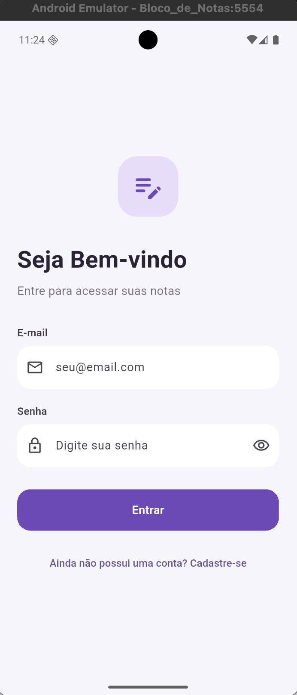 | 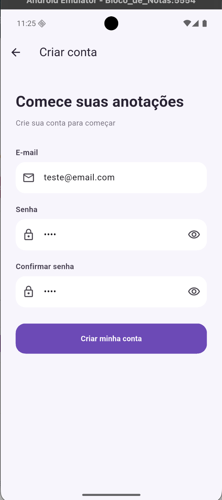 | 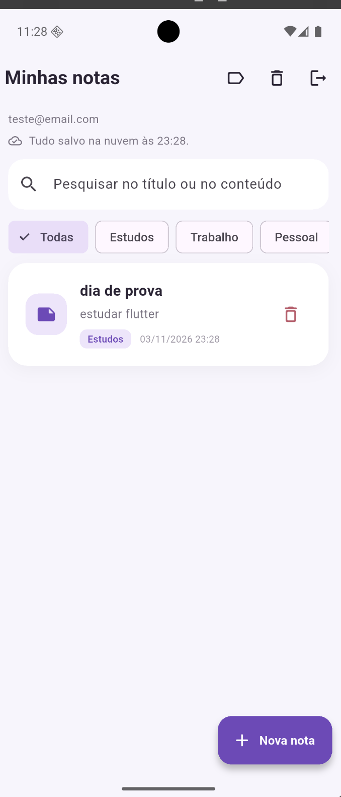 |

| Filtro por categoria | Pesquisa | Nova categoria |
| --- | --- | --- |
| 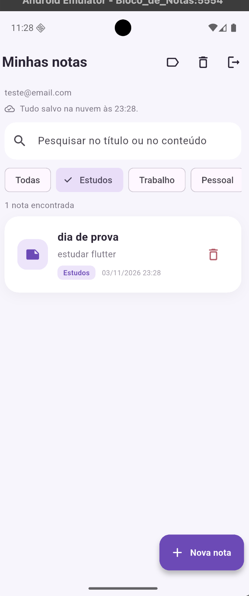 | 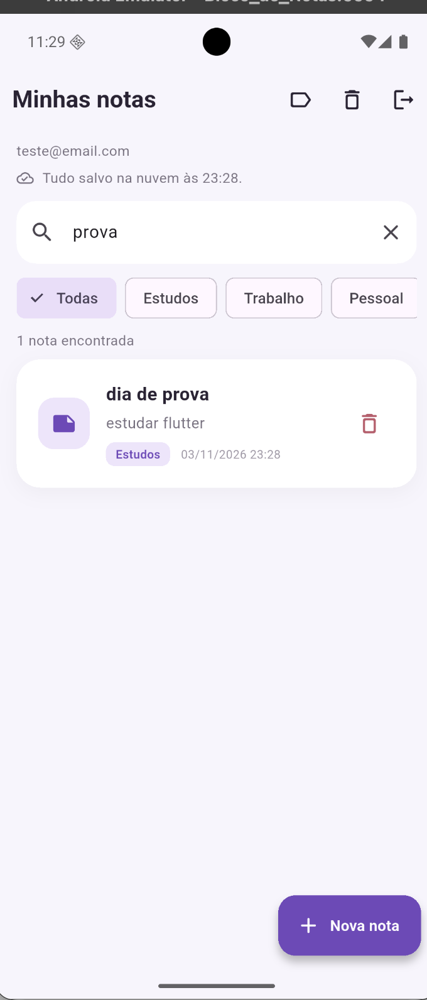 | 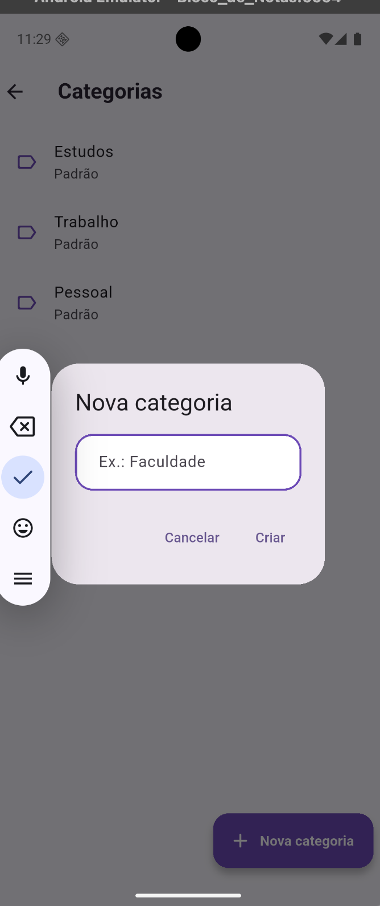 |

| Lixeira | Erro de conexão no login | Nota recuperada da nuvem |
| --- | --- | --- |
| 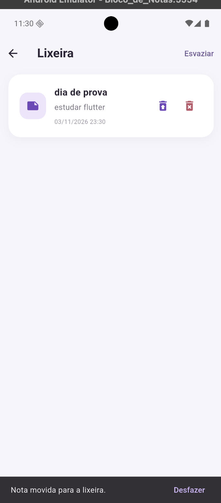 | 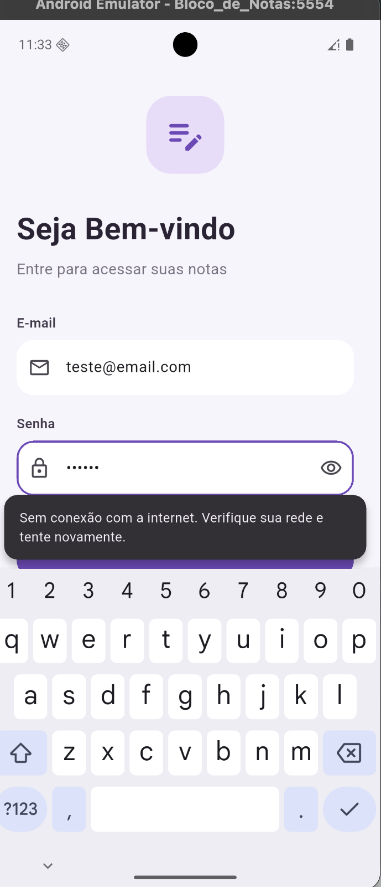 | 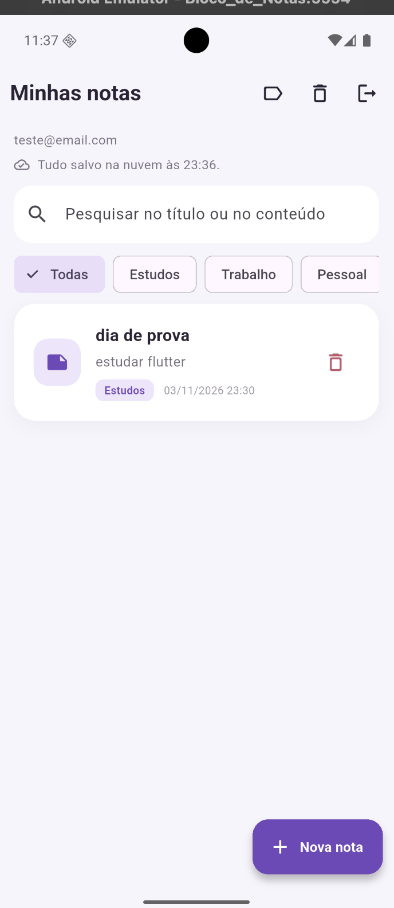 |

A última imagem foi capturada depois de limpar o armazenamento do aplicativo no
Android, o que simula uma instalação nova. Ao entrar com a mesma conta, a nota
foi baixada do Firestore.

### Firebase

**Usuário criado no Firebase Authentication:**

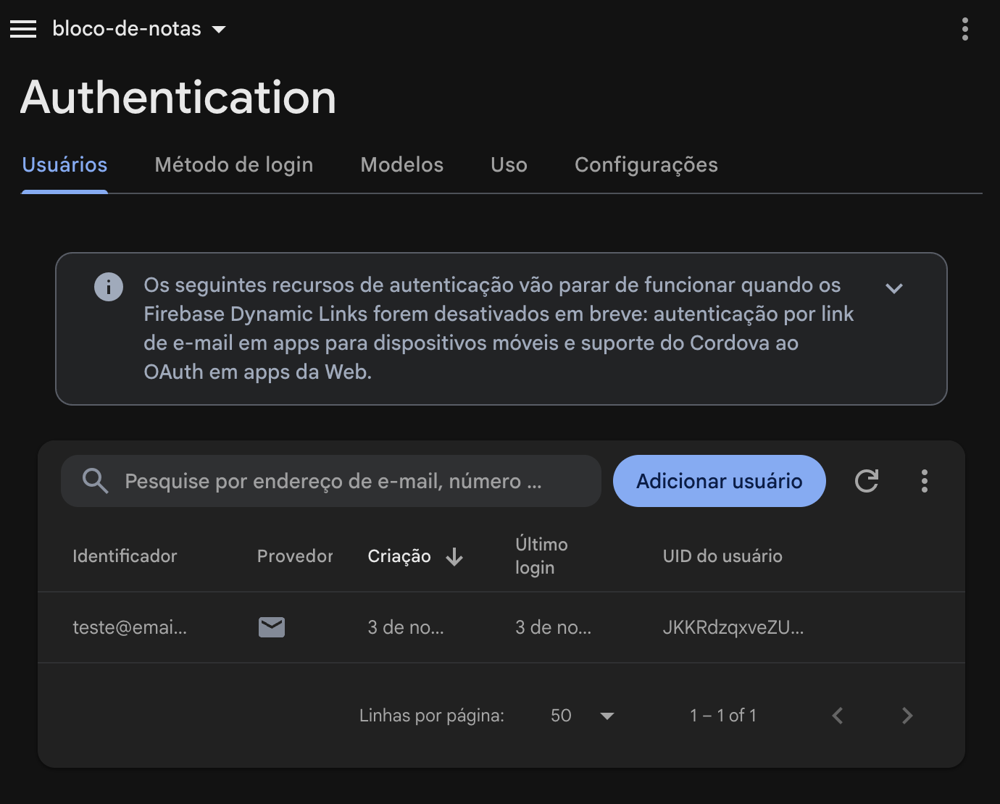

**Nota armazenada no Cloud Firestore, em `users/{uid}/notes/{noteId}`:**

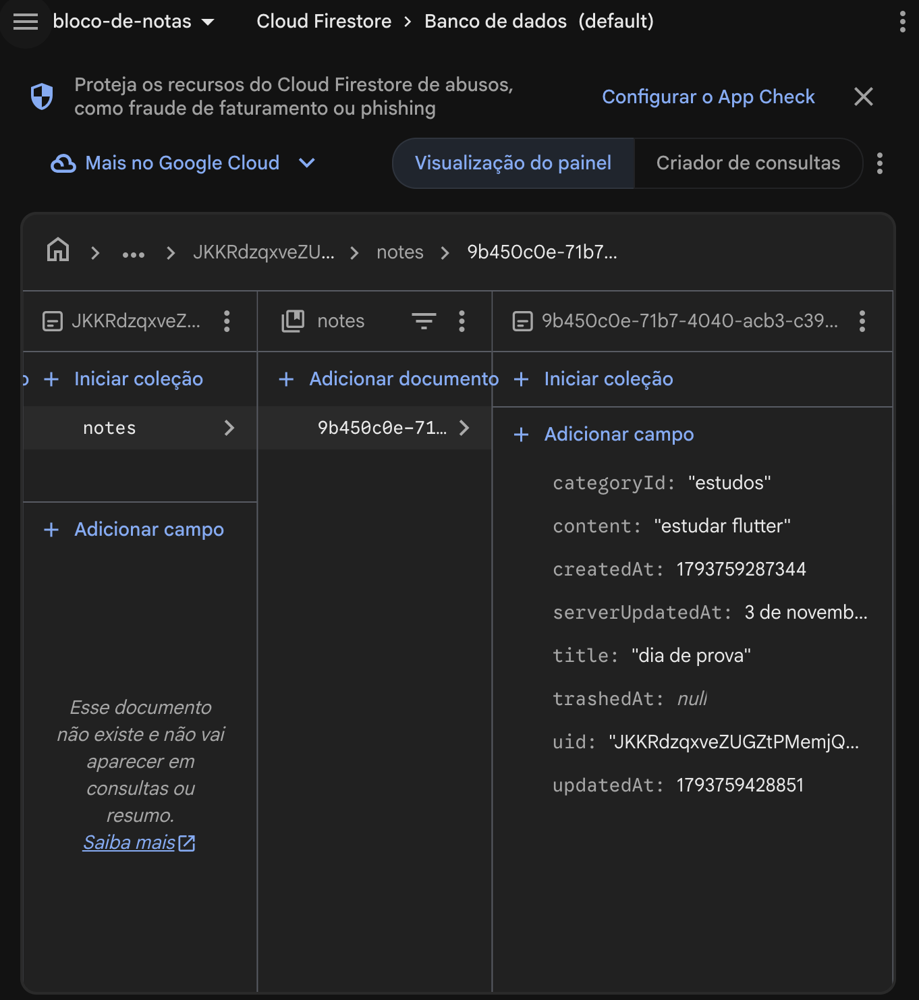

## Como foi verificado

- **`flutter analyze`:** sem problemas.
- **`flutter test`:** 79 testes aprovados.
- **Emulador Android (API 36), com o Firebase real:** cadastro, login, criação de
  notas, categorias padrão, pesquisa, filtro, lixeira com recuperação, mensagem de
  erro sem internet e recuperação da nota após limpar o aplicativo.
- **Regras de segurança:** compiladas e publicadas com `firebase deploy`. O acesso
  do dono aos próprios dados foi usado nos testes acima.
- **Somente nos testes automatizados, com a nuvem simulada:** envio posterior de
  notas criadas sem internet, conflitos entre aparelhos, exclusão em outro aparelho
  e categorias criadas pelo usuário na sincronização.
